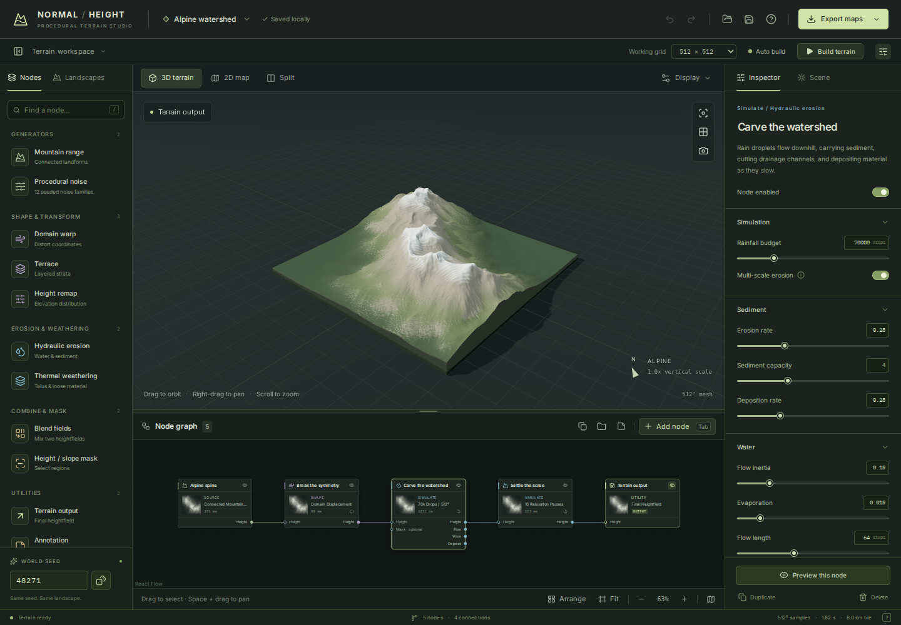
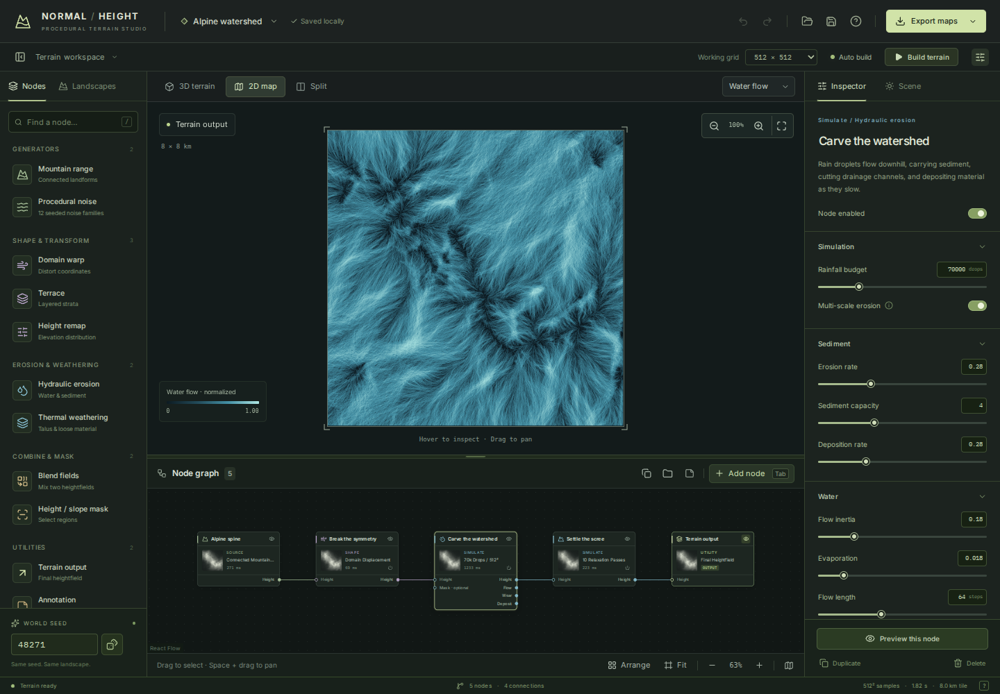

# Normal Height

**A procedural terrain studio for shaping mountain ranges, simulating erosion, and exporting precise heightmaps.**

Normal Height is a React and TypeScript web application. Its visual node graph drives a real Float32 terrain pipeline, evaluated in a dedicated Web Worker. Three.js renders the displaced terrain; a separate 2D view inspects height, normals, slope, flow, wear, and deposition.



_The running production app, captured in Chromium with the editable Alpine watershed graph at 512 × 512._

## Run the application

Use Node.js 22.12 or newer (Node 24 is used in CI).

```bash
npm ci
npm run dev
```

Open the URL printed by Vite. All terrain generation and project storage happen in the browser. No API keys, account, database, or backend service are required.

```bash
npm run build       # Typecheck and generate dist/
npm run preview     # Serve the production build
npm test            # Engine, export, and rendering-math tests
npm run test:e2e     # Build and verify the production app in Chromium
```

For the browser tests, run `npx playwright install chromium` once. CI installs its browser dependencies automatically and uploads screenshots, traces, and the production app as build artifacts.

## What the studio does

### Terrain construction

- **Mountain range generator:** direction, width, relief, sharpness, fractal detail, and distortion. Profiles include connected alpine ranges, broad massifs, volcanic calderas, and badlands.
- **Twelve procedural noise families:** Perlin, simplex, fractal Brownian motion, ridged multifractal, billow, turbulence, Voronoi F1, Voronoi ridges, cellular, wave, warped turbulence, and an independently designed Naki-inspired pattern.
- **Shaping nodes:** domain warp, terrace, and height remap.
- **Combination nodes:** blend fields with mix/add/multiply/min/max operations and optional masks; height and slope masks can also limit hydraulic erosion.
- **Reproducible seeds:** a project seed plus per-node offsets. Changing node positions or selection does not change the generated terrain.
- **Six editable landscape graphs:** Alpine watershed, Granite massif, Desert badlands, Volcanic caldera, Folded highlands, and the spline-enabled River-cut highlands.

### River and ridge designer (Normal Height 1.1)

- Add **River / ridge spline** from **Shape & transform**. The app inserts it before the first hydraulic-erosion stage (or terrain output) when a height connection is available, then opens the 2D editor.
- In the **2D map**, drag numbered control points to reshape the Catmull–Rom curve. Click empty map space to insert near the closest segment; double-click a control point to remove it (at least two points remain). Use the inspector to edit exact X/Y percentages, reverse flow direction, add points, or reset the route.
- Switch **Path operation** between **Carve river and valley** and **Raise mountain ridge**. Change core width, relief and bank/flank spread to adjust the actual geometry. River mode never deposits material, and **Keep river bed downhill** creates a continuous descending bed from point 1 (headwater) to the last point (outlet).
- Switch to **3D terrain** to inspect the sculpted relief and selected spline guide. The terrain is generated as real Float32 samples and continues through subsequent erosion/weathering nodes. The curve is saved non-destructively in portable project files and reevaluated for 16-bit/RAW exports.
- For easier editing, zoom and pan the map; in edit mode, middle/right-drag pans and the wheel zooms. Use **Finish editing** to return to map inspection.

Paths contain 2–24 tile-normalized control points. At high export resolutions, the spline is rasterized using the closest curve segment per pixel rather than accumulating brush stamps, preventing control-point mounds. The river-bed grade is an artistic constraint, not a globally solved hydrological drainage network; automated basin routing, groundwater and GPU fluid solvers remain future work.

### Actual erosion

Hydraulic erosion uses seeded droplets with downhill gradient sampling, inertia, gravity, carrying capacity, brush erosion, deposition, evaporation, and bounded flow length. Removed material is transported and deposited; it is not a visual noise overlay. Multi-scale mode runs wider, longer-lived parcels before finer rills on the requested grid.

Thermal weathering conservatively redistributes material from over-steep slopes to form softer talus transitions. Flow, erosion wear, and deposition are available as diagnostic maps and as graph inputs.

The solver is an artistic particle model, not a calibrated watershed or geological-time simulation. The research notes distinguish this implementation from Terragen's documented workflow and from more expensive grid-fluid solvers.

### Procedural PBR material studio (feature branch)

- **Physical texture sets:** export coordinated base color, combined GL/DX normal, microdetail-only normal, roughness, ambient occlusion, metallic, packed ORM, curvature, and RGBA material weights alongside 16-bit height.
- **Geomorphology-aware layering:** seeded rock/soil/vegetation/snow weights respond to physical slope and aspect, signed 50/150/425 m landform curvature, relative erosion/deposition and flow. Snow prefers stable shaded shelves; rock and transported sediments occupy different terrain positions. Choose alpine, arid, or volcanic biomes.
- **Artist controls:** set snow line, exposed-rock slope, moisture, microdetail physical scale/depth, rock bedding thickness, fracture spacing, and AO in **Scene → PBR material studio**; settings autosave with the project.
- **3D and 2D:** live PBR shading uses proper sRGB albedo, independent roughness/AO, and **detail-only** normals on the displaced mesh. Inspect all material outputs in the 2D channel selector.
- **Live close-up procedural shading:** an optional, world-space 3D microstructure pass supplies band-limited rock joints, soil grit, vegetation breakup and snow crust when zoomed close to the terrain. Material-specific albedo, roughness and normal variations share the same calculated splat masks; ordinary full-tile views skip the added GPU work. The 3D preview remains at three PBR textures, using spare preview-only channels for layer weights; exported ORM and normal files retain their standard layouts.
- **Complete PBR ZIP:** GL/DX normal variants, packed glTF-style ORM and Unity HDRP masks, physical dimensions, channel metadata, and reproducible project in one file. Export encoding runs in a cancellable Web Worker.

**Procedural-only requirement:** every material channel must be generated by Normal Height itself from seeded algorithms, terrain diagnostics, and artist controls. No scanned textures, external PBR maps, uploads, downloaded material libraries, or asset subscriptions are required or planned. The higher-fidelity path uses multi-scale procedural microstructure, material-specific normals and roughness, height-aware transitions, baked triplanar rock fractures and shader-side world-space close-range detail—not external inputs. This does not yet reproduce centimeter-scale detail in coarse 2D exports; future streaming/high-resolution material export is separate work. The current implementation is a foundation; those close-up refinements are tracked in [issue #7](https://github.com/dovvnloading/Normal-Height/issues/7). See [PBR material guide](docs/MATERIALS.md).

### Graph authoring

- Add, connect, reconnect, rename, bypass, duplicate, and delete nodes.
- Explicitly preview an intermediate node without altering the final output.
- Multi-select, group/ungroup, resize groups, and add editable notes.
- Fit, Arrange, zoom, pan, and use a minimap.
- Undo/redo project edits, including graph changes and landscape switches.
- Reject cycles and invalid connections while preserving the last valid preview.

### Preview

- **3D:** real displaced geometry, computed normals, cast shadows, alpine/clay/elevation/PBR materials, physical atmospheric sky, dynamic clouds, matched sun and ambient illumination, contours, wireframe, orbit controls, and image capture.
- **Sky dome (opt-in):** open **Display → Atmosphere & lighting** and choose **Clear day**, **Golden hour**, or **Overcast**, or enable the sky and customize sun position, haze, Rayleigh scattering, exposure, cloud cover, moving cloud shadows, and wind. The physical sky and clouds feed a debounced PBR environment map; solar color, ambient illumination, and fog follow the same weather model. Turning it off restores neutral studio lighting and releases atmospheric GPU resources.
- **Expand ground (opt-in):** open **Display → Landscape context** for a flat, grass-textured meadow beyond the tile. The terrain's outer preview material blends into the meadow with a conforming, smoothed height apron and continuous normals. **No individual grass sprites or blades** are rendered. Adjust ground reach independently of the sky. Meadow resources exist only when enabled; simulations and exported maps stay unchanged.
- **Preview preferences:** sky, cloud, wind, lighting, material and ground settings are validated and stored separately in local browser storage (`normal-height.view.v1`), restoring after a reload without changing portable terrain projects. Weather redraw cadence adapts to GPU render cost, with fully paused idle animation at zero wind. See [Environment implementation and QA](docs/ENVIRONMENT.md).
- **2D:** height, shaded terrain, OpenGL normals, physical slope, flow, wear, and deposition, with pan/zoom and pixel/elevation inspection.
- **Split view:** inspect the surface and map together.
- The 3D display mesh is capped at 512 × 512 vertices. Working simulation grids reach 1024 × 1024 and export grids reach 2048 × 2048. High-resolution exports rerun the entire connected graph.
- Cancellation terminates the active worker. The previous successful terrain stays visible while the next one builds.



### Files

| Output                       | Encoding and meaning                                                                      |
| ---------------------------- | ----------------------------------------------------------------------------------------- |
| Heightmap PNG                | True 16-bit grayscale; actual height minimum/maximum mapped to 0–65535                    |
| Elevation RAW                | Headerless, little-endian Float32 elevations in meters                                    |
| Normal PNG                   | 8-bit RGB OpenGL tangent-space +Y normals, based on physical dimensions                   |
| Full PBR ZIP                 | Coordinated base color, normals (GL/DX/detail), roughness, AO, metallic, ORM, Unity HDRP mask, splat weights, curvature, height, metadata and project |
| Flow / wear / deposition PNG | 8-bit display visualizations; not physical flow-rate measurements                         |
| Project                      | Versioned `.nhterrain.json`, containing graph, parameters, seeds, and physical dimensions |
| ZIP bundle                   | Map, metadata, and reproducible project file                                              |

The 16-bit metadata includes the exact elevation reconstruction formula, min/max, world extent, sample spacing, and orientation. PNG samples are big endian as required by the format. The first image row is north (negative Z in the 3D scene); X increases to the right/east.

Projects autosave locally in the browser. Use **Save project** to keep a portable copy, and **Open project** to restore it. Imports validate version, dimensions, node types, parameter bounds, identifiers, group relationships, and ports before replacing the current graph.

## Appearance

Use the **moon / sun icon in the project header** to switch between the light stone-gray and dark charcoal-gray interfaces. Both use neutral surfaces with muted sage, clay, and slate accents. On first visit the studio follows your device's light/dark preference; clicking the icon saves your choice in this browser (`normal-height.theme.v1`) and overrides the device setting. Your terrain graph, simulation, autosave, and exported files are identical in both themes. The WebGL preview updates its backdrop without rebuilding the heightfield.

## A quick workflow

1. Open **Alpine watershed** and wait for the first terrain to finish.
2. Select **Carve the watershed**. Change rainfall, erosion rate, or sediment capacity.
3. Choose **2D map → Water flow** to inspect the drainage network, or use **Split**.
4. Use the eye on **Alpine spine** to compare the uneroded source. Return to Terrain output when finished.
5. Open **Scene** to set tile width and elevation scale. Viewport exaggeration changes the display only.
6. Export a **16-bit PNG** at the desired grid size, with the metadata bundle enabled.

## Architecture

```text
src/model/        Project types, node definitions, editable presets, file validation
src/engine/       Seeded noise, graph evaluator, hydraulic/thermal solvers, worker
src/components/   Application panels, React Flow graph, 2D/3D viewport, export dialog
src/render/       Three.js terrain scene, physical normals, diagnostic color mapping
src/materials/    Biome-aware procedural PBR material and map synthesis
src/export/       16-bit PNG encoder, Float32 RAW encoder, ZIP metadata
src/hooks/        Worker lifecycle, debounced evaluation, cancellation, stale state
tests/           Numerical, encoding, and browser workflow verification
```

The graph evaluator follows dependencies from the previewed node or final output, memoizes each reachable node, and reports node timings and thumbnails. Height arrays are immutable across node boundaries. Worker results use transferable buffers. A conservative memory preflight bounds high-resolution graphs before expensive allocations. PBR ZIP encoding uses a separate worker to keep the interface responsive and cancelable.

## Hosting — GitHub Pages

The public app is deployed from the `main` branch through [the GitHub Pages workflow](.github/workflows/deploy-pages.yml). After Pages is enabled, the site URL is **https://dovvnloading.github.io/Normal-Height/**.

**One-time repository setup:** On GitHub, open **Settings → Pages → Build and deployment → Source**, choose **GitHub Actions**, and save. The workflow deploys the Vite production build to GitHub Pages on each push to `main`. If the latest deployment was triggered before Pages was enabled, run the **Deploy Normal Height to GitHub Pages** workflow manually from the **Actions** tab.

The production build is a client-side webapp in `dist/`. It must be served over HTTP(S); Web Workers cannot be reliably loaded from `file://`. Vite's relative asset base supports subdirectory hosting. Project state stays in the visitor's browser unless they explicitly download it. GitHub Pages requires no server, API keys, or database for this application.

