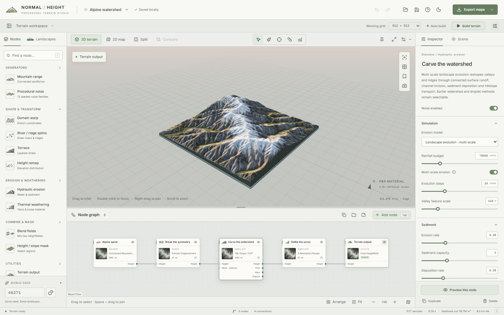
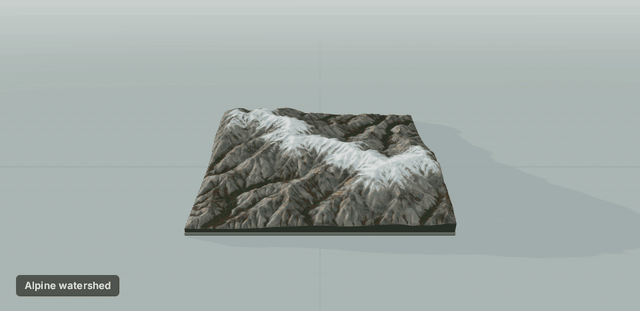
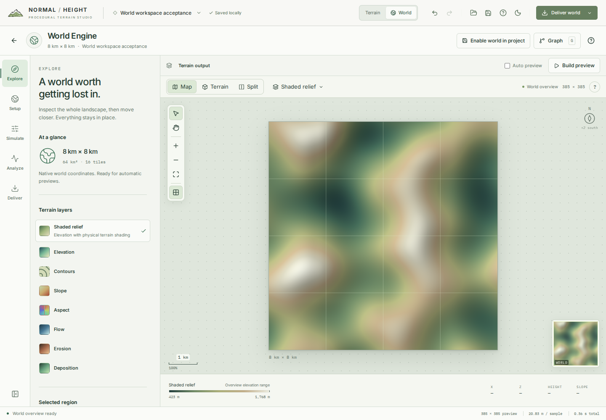
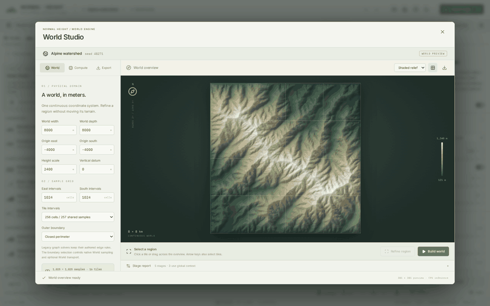
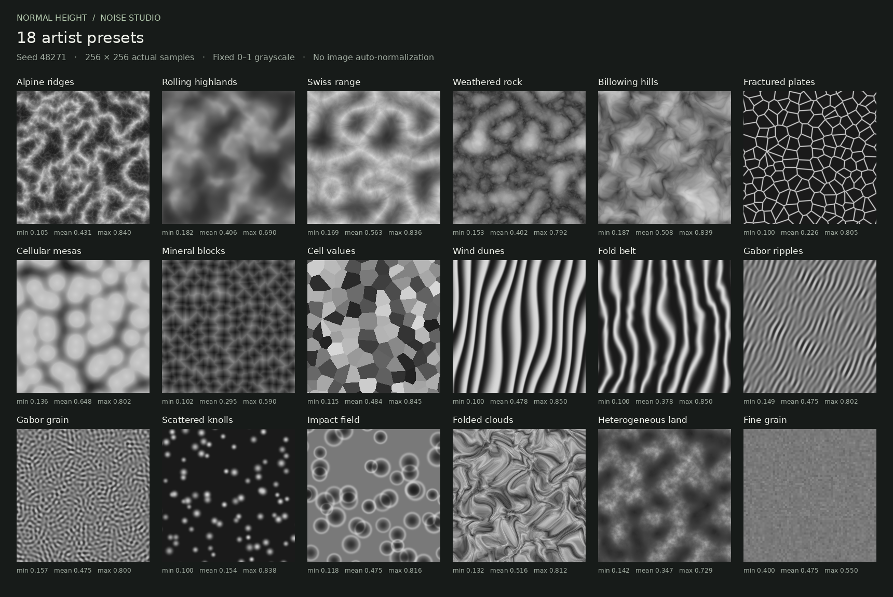
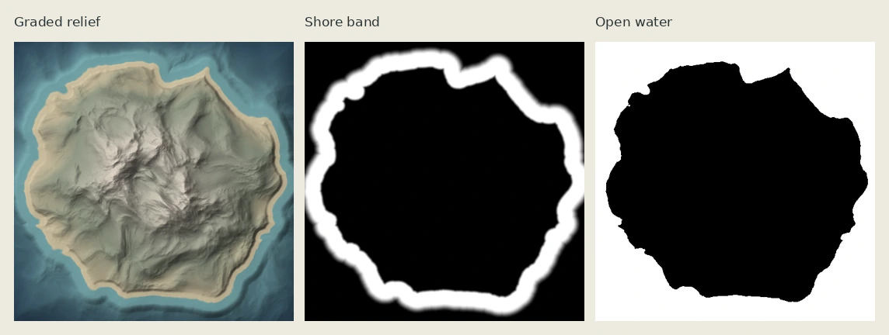
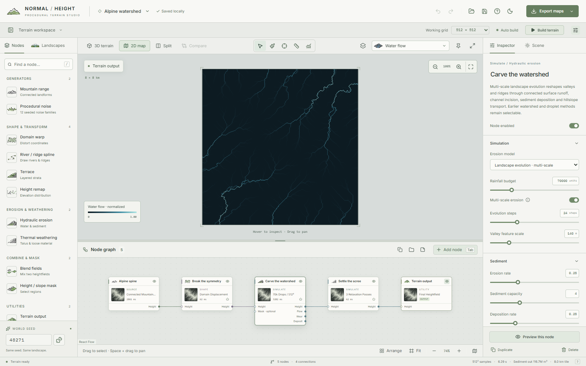

# Normal Height

**A procedural terrain studio for shaping mountain ranges, simulating erosion, and exporting precise heightmaps.**

Normal Height is a React and TypeScript web application. Its visual node graph drives a real Float32 terrain pipeline in a persistent, incrementally cached Web Worker. Three.js renders the displaced terrain; a separate 2D view inspects height, normals, slope, flow, wear, and deposition. **World Studio** extends the graph into continuous Cartesian worlds, regional builds, and tiled export.



_The running production app with the editable Alpine watershed graph at 512 × 512, PBR material and golden-hour lighting._



_The current application, rendered live. Regenerate the screenshots and GIFs with `node scripts/readme-media.mjs`. [Capture provenance and instructions](docs/MEDIA.md) distinguish software rendering from hardware performance evidence._

## World Engine

This engineering preview implements the continuous-world workflow. The release
qualification limits below remain explicit in the app, guides, and exports.



Open **World Studio** in the workspace toolbar. Set the physical extent and
sample intervals, build an overview, then click or drag across tiles and choose
**Refine region**. The same coordinates identify a sample in every tile; edge
tiles crop to the exact domain. A rectangular world works with native World
stages. Legacy square-domain sources and solvers explicitly require a square
domain.



| Capability           | Current implementation                                                                                                                                                                  |
| -------------------- | --------------------------------------------------------------------------------------------------------------------------------------------------------------------------------------- |
| Persistent compute   | Immutable, byte-bounded per-node cache; downstream edits reuse valid upstream fields; diagnostics show hits, misses, timings and memory estimates                                       |
| World coordinates    | Explicit project v2, rectangular local Cartesian meters, independent origins and dimensions, canonical shared samples, partial tiles, region builds                                     |
| Native graph detail  | Noise Studio v3, remap, terrace, blend, height/slope masks and bounded warp; global stages share one reference solution and reconstruct their displacement over the native input        |
| Compute selection    | CPU reference, Auto, or WebGPU; remap/terrace/blend/height-mask WGSL kernels must pass a runtime numerical probe before use; unsupported/device failures are reported                   |
| Coupled transport    | Optional experimental whole-domain water, sediment and thermal transport, global drainage, open/closed boundaries, synchronized shared-face exchange, and separate conservation ledgers |
| World export         | Exact 4K/8K sample profiles, bounded tiles, PNG16/UInt16/Float32 height, flow/wear/deposition/slope, halo-aware normals, selected named masks, checksums and reproduction manifest      |
| Delivery profiles    | Generic Cartesian output plus experimental Unreal/Unity grids and import settings; real engine import qualification remains pending                                                     |
| Local region storage | Optional 64 MiB IndexedDB cache of completed CPU regions, version/checksum validation, atomic admission and memory fallback; separate from authored project storage                     |

**Resolution is reported per stage.** An 8192² package may include a coarse
global erosion or transport solution. The manifest records that simulation's
actual spacing. Legacy single-tile exports retain their existing 2048² cap;
World Studio is the separate tiled path. Full World PBR baking, raster/coast
integration from #42, hardware GPU performance qualification, production engine
imports, and 32K export qualification remain follow-up work.


The recorded Alpine CPU fixture reduced a downstream remap edit from a median
**4,593 ms uncached to 18.2 ms with cache reuse**, with exact output equivalence.
A complete native Perlin → remap → terrace → output graph exported at **4096²
in 33.0 s** and **8192² in 148.2 s** in the documented Node CPU environment.
Actual Chromium downloads of that native CPU graph completed at **4096² in
86.9 s** and **8192² in 345.1 s** on a separate Xeon CI runner; every PNG tile
and shared border was independently verified. These are fixture measurements,
not general browser/GPU speed promises. See the
[World Engine guide, evidence and limitations](docs/WORLD_ENGINE.md),
[cache measurements](docs/benchmarks/world-engine-cpu.json), and
[export measurements](docs/benchmarks/world-engine-cpu-export.json), and
[actual browser export evidence](docs/benchmarks/world-engine-browser-export.json).

## Run the application

Use Node.js 22.12 or newer (Node 24 is used in CI).

```bash
npm ci
npm run dev
```

Open the URL printed by Vite. All terrain generation and project storage happen in the browser. No API keys, account, database, or backend service are required.

```bash
npm run build       # Typecheck and generate dist/
npm run preview     # Serve the production build
npm test            # Engine, export, and rendering-math tests
npm run test:e2e    # Optional full browser suite; run npm run build first
```

**Fast terrain checks run `npm test` and `npm run build`.** Pull requests that touch viewport, noise, PBR export, or World Engine code also run their targeted browser acceptance workflows. World correctness checks verify the selected commit without changing the branch. **GitHub Actions → World Studio media (manual) → Run workflow** captures the actual app as downloadable artifacts; publishing changed captures to the selected branch requires its explicit `publish` option. Extended browser QA and mesh benchmarks remain available through **GitHub Actions → Extended terrain QA (manual only) → Run workflow**. Locally, build first, install Chromium with `npx playwright install chromium`, then run `npm run test:e2e`. Hardware benchmarking instructions are in [docs/MESH_PERFORMANCE.md](docs/MESH_PERFORMANCE.md).

## What the studio does

### Terrain construction

**Dissected orogenic range** uses the existing editable mountain uplift
profile but adds actual **incised tributary valleys and interfluve ridges**
to the exported heightfield. The source builds an outlet-connected,
seeded stream tree and carves continuous, catchment-scaled riverbed and
valley-bank feature kernels. The shallow-routing diagnostic does not
become a raised white river line: every cut is a negative elevation
change relative to the original source.

To compare, select a Mountain range node and use
**Landform → Dissected orogenic range** and its
**Stream-network dissection** control. Strength zero returns the previous
Classic alpine range exactly; explicit older profiles remain selectable.
The Alpine watershed and Folded highlands presets use the new source,
which can continue through existing hydraulic and thermal erosion stages.

This approach is an independently written, art-directed reconstruction
informed by published hydrology-guided terrain-feature methods
([Génevaux et al. 2013](https://doi.org/10.1145/2461912.2461996),
[Cordonnier et al. 2016](https://doi.org/10.1111/cgf.12820)).
It is not a commercial Terragen/Gaea clone or a validated physical
fluid simulation. Judge its actual grayscale Height map and terrain
relief against the reference, not its Flow mask or material textures.

- **Mountain range generator:** direction, width, relief, sharpness, fractal detail, and distortion. Profiles include connected alpine ranges, broad massifs, volcanic calderas, and badlands.
- **Noise Studio v3:** 14 base generators, 10 fractal modes, independently seeded domain distortion, physical feature sizes, editable remap curves, and 18 artist presets. The original 12 noise families remain available as versioned compatibility choices.
- **Shaping nodes:** domain warp, terrace, and height remap.
- **Combination nodes:** blend fields with mix/add/multiply/min/max operations and optional masks; height and slope masks can also limit hydraulic erosion.
- **Reproducible seeds:** project-linked or independent Studio seeds, optional seed names, resolved stream locks, and separate warp seeds. Explore nine variations, bookmark looks, and restore recent choices. Moving or reordering nodes does not change the random streams.
- **Editable landscape graphs:** regional uplands, mountains, badlands, calderas, coastal islands, spline-enabled highlands, and three Studio examples for ridges, dunes, and crater fields.

### Noise Studio



Open **Nodes → Browse Noise Studio** to explore generated previews, or add a
**Procedural noise** node. The inspector separates the base generator from its
fractal structure, distortion, coordinates, shaping, and sampling quality.

| Stage       | Choices                                                                                                                                                    |
| ----------- | ---------------------------------------------------------------------------------------------------------------------------------------------------------- |
| Base field  | OpenSimplex2S, OpenSimplex2, Perlin, Value, Cubic Value, Worley/cellular, sparse Gabor, sparse spots, craters, wave, dunes, folded strata, white, Gaussian |
| Fractal     | Single layer, fBm, ridged, billow, absolute turbulence, ping-pong, hybrid, heterogeneous, Swiss, Jordan                                                    |
| Cellular    | F1, F2, F2−F1, F1/F2, cell value, smooth F1, true Euclidean edge distance; three distance metrics where applicable                                         |
| Distortion  | Independent, progressive, or curl displacement with separate frequency, layer controls and seed                                                            |
| Coordinates | Tile frequency or feature size in meters, separate X/Y scaling, rotation, translation, octave rotation                                                     |
| Output      | Black/white levels, gamma, contrast, bias, invert, editable curve, amplitude, elevation offset                                                             |
| Sampling    | Footprint filtering, optional 4/16 samples, unfiltered reference, seamless four-way blending                                                               |

**Capture A** retains an independent reference while you edit B. The library and
seed explorer generate actual heightfields in cancellable workers. Applying a
preset, seed variation, imported recipe, or seed lock is one undo step.

**Export source** writes the selected noise directly at up to **8192 × 8192**,
with 16-bit PNG or Float32 RAW, a versioned recipe and reproduction metadata.
Generation and encoding use strips; the final archive still occupies browser
memory. This export contains the procedural source before downstream graph
operations. The existing single-tile graph exporter retains its 2048² limit;
World Studio provides a separate bounded, tiled full-graph export path with
per-stage simulation and reconstruction metadata.

See the [Noise Studio guide](docs/NOISE_STUDIO.md) for controls, seed semantics,
reproducibility, measured performance and quality limits, and the
[research and numerical contracts](docs/NOISE_RESEARCH.md) for algorithm sources.

### Procedural noise compatibility

New Procedural noise nodes use **Noise Studio (v3)**. Existing v2 and legacy
nodes keep their previous sampling until you choose **Upgrade to Studio**.
Upgrading changes the pattern and is undoable. The algorithm version is saved
with each node. Existing authored landscape presets keep their original version;
the new Studio landscapes opt in explicitly.

**Corrected sampling (v2)** bounds Perlin without hard-clipping its extrema, smoothly compresses strong
turbulence and Voronoi ridge values, makes Wave's fractal controls effective,
and makes Naki's zero Warp amount a true unwarped lobe field. Single-layer
families hide the unused fractal controls. The engine's calibrated mountain,
material and erosion noise remains unchanged.

Projects saved without a noise algorithm are loaded in **Original sampling
(legacy)** for each existing noise node. Switch that node to corrected sampling
explicitly to adopt the new appearance; its seed and other authored parameters
are retained. The selection is serialized with the project.

Corrected sampling also fades fractal octaves as their lattice spacing
approaches the output grid's Nyquist limit. The footprint uses the authored
frequency, rotation and stretch; warped fractal detail also estimates local
coordinate expansion. Low-frequency amplitude is retained rather than
renormalized when fine detail becomes unresolved. Folded fractals approximate
unresolved octaves by their ensemble means. This is a conservative octave
filter, not exact analytic integration of the entire noise spectrum (especially
for highly anisotropic stretch, nonlinear warps, and single-layer cellular
or wave patterns). Fine detail can resolve as export resolution increases.

### Imported terrain, coastlines and placement masks

Open **Landscapes → Volcanic island** for a wired example. Change **Sea level** on *Grade the coast*, then open **Export → Format → Named masks** and choose *Shore band* or *Open water*. Both masks follow the same coastline as the exported terrain.



*Three outputs from the same 512 × 512 graph. Shaded relief uses elevation colors to show the submerged shelf. The mask panels show the exported weight range from black (0) to white (1).*

| Node | How to use it |
| --- | --- |
| **Heightmap import** | Choose a source file in the inspector and connect **Height** to a shaping node or Terrain output. It embeds the samples in the project, fits the raster edge to edge with bilinear interpolation, and offers vertical gain, offset in meters, and a north/south flip. |
| **Coastal shelf** | Set sea level as a fraction of the project height scale. Set beach and shelf widths in meters and their angles in degrees. By default water must reach a tile edge through side-adjacent cells. **Include inland lakes** also grades enclosed shorelines. **Profile strength** at zero keeps elevations and still produces both masks. |
| **Mask output** | Connect any scalar port, then rename the node in the inspector. Export its branch as a 16-bit grayscale PNG at the selected grid size. Values are clamped to a fixed linear 0–1 range, so a constant 25% weight stays 25%. The optional ZIP includes the editable project and source connection. |

Heightmap import accepts non-interlaced 8- or 16-bit grayscale PNGs up to 2048 samples per side. Headerless RAW grids must be square and little-endian. Use `.r16` or `.raw` for unsigned 16-bit samples and `.r32` or `*-f32le.raw` for Float32 elevations in meters. Integer samples span the project height scale. To restore a height PNG exported by this studio, set **Vertical gain** to its metadata elevation range divided by the project height scale and **Elevation offset** to its minimum elevation in meters. A Float32 RAW export carries meter values directly. Projects can embed up to 16 MiB of decoded samples across import nodes.

### River and ridge designer (Normal Height 1.1)

- Add **River / ridge spline** from **Shape & transform**. The app inserts it before the first hydraulic-erosion stage (or terrain output) when a height connection is available, then opens the 2D editor.
- In the **2D map**, drag numbered control points to reshape the Catmull–Rom curve. A click inserts into the nearest visible curved span; **Add point** in the inspector splits the longest span at its approximate arc-length midpoint. Double-click or focus a handle and press Delete/Backspace to remove it (at least two points remain). Focus a handle and use arrows to nudge it by 0.1% of the tile, or Shift+arrows for 1%. The inspector's X/Y percentage fields commit on Enter or blur and cancel on Escape. Reverse flow or reset the route with one undoable action.
- The map displays direction arrows for rivers, distinct headwater/outlet handles, and a shaded core/outer-influence guide while editing (hidden at zero relief). The inspector reports approximate centerline length, core radius, and outer reach in project meters. The guide depicts authored influence, not simulated channel width or the exact rasterized cut.
- Switch **Path operation** between **Carve river and valley** and **Raise mountain ridge**. Change core width, relief and bank/flank spread to adjust the actual geometry. River mode never deposits material, and **Keep river bed downhill** creates a continuous descending bed from point 1 (headwater) to the last point (outlet).
- Switch to **3D terrain** to inspect the sculpted relief and selected spline guide. The terrain is generated as real Float32 samples and continues through subsequent erosion/weathering nodes. The curve is saved non-destructively in portable project files and reevaluated for 16-bit/RAW exports.
- Drag empty map space (or middle/right-drag) to pan, use the wheel to zoom, or pinch with two fingers on the map. A second finger cancels the uncommitted draft and hands off to navigation. Handle drags commit only on release; Escape, an undo shortcut during the gesture, pointer cancellation, or loss of browser focus cancels the draft without adding an undo entry. Use **Finish editing** to return to map inspection.

Paths contain 2–24 tile-normalized control points. At high export resolutions, the spline is rasterized using the closest curve segment per pixel rather than accumulating brush stamps, preventing control-point mounds. The river-bed grade is an artistic constraint, not a globally solved hydrological drainage network; automatic spline placement from basins, groundwater and GPU fluid solvers remain future work. World Studio now provides separate whole-domain drainage analysis and optional conservative transport; that does not automatically reroute an authored spline.

### Hydraulic erosion models

The Hydraulic erosion node provides five selectable models:

- **Landscape evolution · multi-scale (default):** Uses priority-flood
  depression routing and multiple-flow-direction runoff to grow connected
  tributaries and valleys. Suspended sediment follows **the same flow fractions
  as runoff**. Sediment transport capacity uses rain-weighted watershed area in
  square meters rather than a raster-dependent contributing-pixel count.
- **Hybrid · landscape + fluid (experimental):** First develops the connected
  drainage network, then runs local virtual-pipe hydraulic transport on the
  evolved heightfield. The mobile soil/alluvium layer is passed between the
  two models; the source heightfield remains unchanged.
- **Hydraulic fluid grid · experimental:** Solves eight-neighbor water flux
  with available-water limiting and advects suspended sediment on the same
  signed links. Carry water, suspended material, and mobile alluvium between
  128/256/512 simulation stages instead of discarding them when refining.
  Finer physical cells use smaller hydraulic substeps. Physical rainfall is
  independent of the source terrain's vertical relief.
- **Watershed v1 · stream power:** Maintained for legacy comparisons.
- **Legacy · particle droplets:** The deterministic older particle solver.

Landscape, fluid, and hybrid modes split the terrain into a resistant bedrock
substrate and a mobile material layer. **Mobile soil thickness** (meters) sets
the initial cover _within_ the original surface (it does not add elevation).
**Bedrock resistance** sets how slowly exposed rock erodes after the mobile
layer is removed. **Valley feature scale**, **Evolution steps**, **Hillslope
transport**, and **Riverbank angle** retain their artistic terrain controls.

All models preserve the old output channels (Height, Flow, Wear, Deposit) and
the saved project structure. Existing saved nodes with explicit methods keep
their algorithm; missing method values still use landscape evolution. No
automatic migration is needed.

The two latest solvers expose an additional `sedimentBudget` result for
debugging: eroded, deposited, **boundary-exported**, and **still-suspended**
material in approximate cubic meters, with a numerical balance residual.
These numbers are measured during transport at simulation resolution, whereas
the preexisting `exportedSediment` scalar continues to mean net final
heightfield change in output-grid sample units, for backward compatibility.
Resampling and optional bedrock-preservation filtering mean the two measures
should not be confused or expected to match exactly.

The fluid and hybrid options remain **experimental artistic erosion models**,
not calibrated geophysical simulations. Visual quality should be judged using
the actual Height and shaded-relief maps, not the Flow channel alone. See
[hydrological design and limitations](docs/RESEARCH.md).

### Procedural PBR material studio (feature branch)

- **Physical texture sets:** export coordinated base color, combined GL/DX normal, microdetail-only normal, roughness, ambient occlusion, metallic, packed ORM, curvature, and RGBA material weights alongside 16-bit height. Audit the four individual rock/soil/vegetation/snow masks as grayscale percentages in the 2D map.
- **Geomorphology-aware layering:** seeded rock/soil/vegetation/snow weights respond to physical slope and aspect, signed 50/150/425 m landform curvature, relative erosion/deposition and flow. Snow prefers stable shaded shelves; rock and transported sediments occupy different terrain positions. Choose alpine, arid, or volcanic biomes.
- **Artist controls:** set snow line, exposed-rock slope, moisture, microdetail physical scale/depth, rock bedding thickness, fracture spacing, and AO in **Scene → PBR material studio**; settings autosave with the project.
- **Sub-polygon displacement:** open **Scene → Surface & light → Sub-polygon displacement**. At 0× the mesh shows the terrain elevation. At 1×, rock, soil, vegetation and snow raise or recess the surface by their authored relief in meters. PBR, Alpine, Clay and Elevation share those triangles. Zoom to a ridge in Clay or Wireframe to see its silhouette change. The 2D **Material relief** channel shows the signed relief at the working resolution.
- **Live close-up procedural shading:** double-click a rock face or valley in 3D to focus the camera there, then zoom much closer than before. An optional world-space 3D microstructure pass supplies band-limited rock joints, soil grit, vegetation breakup and snow crust when zoomed close to the terrain. Material-specific albedo, roughness and normal variations share the same calculated splat masks; ordinary full-tile views skip the added GPU work. The 3D preview remains at three PBR textures, using spare preview-only channels for layer weights; exported ORM and normal files retain their standard layouts.
- **Complete PBR ZIP:** GL/DX normal variants, packed glTF-style ORM and Unity HDRP masks, physical dimensions, channel metadata, and reproducible project in one file. Export encoding runs in a cancellable Web Worker.

**Painting studio.** Select **Paint** or press **B** for a dedicated material workspace in 3D, 2D, or Split. Paint Rock, Soil, Vegetation, and Snow with numeric brush controls, pen pressure, stabilization, textured tips, symmetry, factory presets, and saved custom brushes. Hold **Space** to navigate without leaving Paint; **Alt-click** samples a substrate. A live PBR preview refines into the full working-resolution material after each undoable gesture.

Organize authored paint into named layers with visibility, locking, opacity, reordering, layer masks, and local erase. Constrain a brush or an entire layer by elevation, slope, runoff, curvature, facing direction, and natural breakup. Polygon selections, connected fills, source replacement, and a material blending brush support larger edits. **Before** previews the procedural surface without modifying the project. Layers, strokes, pressure, and selections persist in project files and complete PBR exports; legacy painted projects remain readable. [Painting studio guide](docs/PAINTING_STUDIO.md) · [Material guide and visual comparisons](docs/MATERIALS.md).

### Graph authoring

- Add, connect, reconnect, rename, bypass, duplicate, and delete nodes.
- Explicitly preview an intermediate node without altering the final output.
- Multi-select, group/ungroup, resize groups, and add editable notes.
- Fit, Arrange, zoom, pan, and use a minimap.
- Undo/redo project edits, including graph changes and landscape switches.
- Reject cycles and invalid connections while preserving the last valid preview.

### Preview

- **3D:** real displaced geometry, computed normals, cast shadows, alpine/clay/elevation/PBR materials, physical atmospheric sky, dynamic clouds, matched sun and ambient illumination, contours, wireframe, orbit controls, and image capture.
- **Sky dome (opt-in):** open **Display → Atmosphere & lighting** and choose **Clear day**, **Golden hour**, or **Overcast**, or enable the sky and customize sun position, haze, Rayleigh scattering, exposure, cloud cover, moving cloud shadows, and wind. The physical sky and clouds feed a debounced PBR environment map; solar color, ambient illumination, and fog follow the same weather model. Turning it off restores neutral studio lighting and releases atmospheric GPU resources.
- **Expand ground (opt-in):** open **Display → Landscape context** for a flat, grass-textured meadow beyond the tile. The terrain's outer preview material blends into the meadow with a conforming, smoothed height apron and continuous normals. **No individual grass sprites or blades** are rendered. Adjust ground reach independently of the sky. Meadow resources exist only when enabled; simulations and exported maps stay unchanged.
- **Preview preferences:** sky, cloud, wind, lighting, material and ground settings are validated and stored separately in local browser storage (`normal-height.view.v1`), restoring after a reload without changing portable terrain projects. Weather redraw cadence adapts to GPU render cost, with fully paused idle animation at zero wind. See [Environment implementation and QA](docs/ENVIRONMENT.md).
- **2D:** height, shaded terrain, OpenGL normals, physical slope, flow, wear, and deposition, with pan/zoom and pixel/elevation inspection.
- **Split view:** inspect the surface and map together with a draggable, keyboard-adjustable divider. When the available terrain pane is compact, the two views stack vertically even in a wider desktop window.
- **Terrain investigation:** select Inspect, Measure or Profile; pin linked 2D/3D source locations, read physical elevation/slope/flow, and measure horizontal/surface distance, grade and a sampled elevation transect. 2D inspection also works using arrow keys plus Enter.
- **Non-destructive comparisons:** Pin a finished node or terrain output as a baseline, then compare a new result using a before/after wipe or an off-thread, physically scaled elevation-difference map. Different resolutions are resampled, but tiles must have the same world width. Inspect exact source-interpolated elevation deltas and approximate sampled cut/fill volumes without changing source/export arrays or pretending to measure hydraulic sediment budgets.
- **Workspace ergonomics:** Focus mode hides editor docks without remounting 3D, split ratio and map framing persist, camera orientation follows the actual view, and N/E/S/W camera directions plus local camera bookmarks are available. Grouped map channels, diagnostic-opacity overlays and pinch gestures support inspection.
- **Viewport field guide:** [Navigation, measurements, comparisons, accessibility and validation](docs/VIEWPORT_UX.md). Use **Ctrl/⌘ K** for the node palette or **F** while in the preview to focus the viewport.
- **Adaptive 3D terrain mesh:** the live preview keeps the original full-resolution Float32 terrain and independently refines nearby visible regions according to projected pixel size (bounded at 340K/680K/1.4M vertices for Balanced/High/Ultra). Source-derived continuous normals, monotone cubic height reconstruction, crack-free inter-tile edges, and matching outer skirts/meadow aprons reduce faceted slopes, serrated silhouettes, and zoom-related grid artifacts. The status overlay shows current triangle count, not a misleading fixed 512² mesh. Changing mesh fidelity does not rerun erosion or modify exports.
- The original single-tile editor offers working grids up to 1024 × 1024 and graph export up to 2048 × 2048. Solver-specific coarse grids can be lower; mesh refinement does not add hydraulic simulation samples. World Studio provides a separate tiled 4K/8K output path and records the actual sampling and simulation spacing per stage. Close-up mesh refinement can resolve procedural material relief between the terrain samples.
- Completed builds keep the worker and its bounded immutable cache alive. Cancellation terminates an active noncooperative legacy solver and releases that worker's cache. The previous successful terrain stays visible while the next one builds; its physical measurements and label retain the **last completed field's** dimensions, elevation scale and source-stage identity rather than adopting unbuilt editor changes.



### Files

| Output                       | Encoding and meaning                                                                                                                                                                       |
| ---------------------------- | ------------------------------------------------------------------------------------------------------------------------------------------------------------------------------------------ |
| Heightmap PNG                | True 16-bit grayscale; actual height minimum/maximum mapped to 0–65535                                                                                                                     |
| Elevation RAW                | Headerless, little-endian Float32 elevations in meters                                                                                                                                     |
| Normal PNG                   | 8-bit RGB OpenGL tangent-space +Y normals, based on physical dimensions                                                                                                                    |
| Full PBR ZIP                 | Coordinated base color, normals (GL/DX/detail), roughness, AO, metallic, ORM, Unity HDRP mask, splat weights, curvature, 16-bit terrain height, 16-bit signed relief, metadata and project |
| Flow / wear / deposition PNG | Legacy single-tile 8-bit display visualizations; not physical flow-rate measurements                                                                                                       |
| Noise source ZIP             | Up to 8K PNG16 or Float32 scalar RAW, `.nhnoise.json` recipe, resolved seed and decoding metadata                                                                                          |
| World package ZIP            | Tiled PNG16/UInt16/Float32 heights, PNG16 diagnostics and named masks, RGB normals, checksums, source revision, physical transforms, stage reports, and original project                   |
| Project                      | Versioned `.nhterrain.json`, containing graph, parameters, seeds, and physical dimensions                                                                                                  |
| ZIP bundle                   | Map, metadata, and reproducible project file                                                                                                                                               |

The 16-bit metadata includes the exact elevation reconstruction formula, min/max, world extent, sample spacing, and orientation. PNG samples are big endian as required by the format. The first image row is north (negative Z in the 3D scene); X increases to the right/east.

Every session opens a fresh landscape. Your work autosaves locally in the browser but is never reopened by itself: use **Restore last session** in the header to continue it, **Save project** to keep a portable copy, and **Open project** to restore that. Imports validate version, dimensions, node types, parameter bounds, identifiers, group relationships, and ports before replacing the current graph.

## Appearance

Use the **moon / sun icon in the project header** to switch between the light stone-gray and dark charcoal-gray interfaces. Both use neutral surfaces with muted sage, clay, and slate accents. On first visit the studio follows your device's light/dark preference; clicking the icon saves your choice in this browser (`normal-height.theme.v1`) and overrides the device setting. Your terrain graph, simulation, autosave, and exported files are identical in both themes. The WebGL preview updates its backdrop without rebuilding the heightfield.

## A quick workflow

1. Open **Alpine watershed** and wait for the first terrain to finish.
2. Select **Carve the watershed**. Change rainfall, erosion rate, or sediment capacity.
3. Choose **2D map → Water flow** to inspect the drainage network, or use **Split**.
4. Use the eye on **Alpine spine** to compare the uneroded source. Return to Terrain output when finished.
5. Open **Scene** to set tile width and elevation scale. Viewport exaggeration changes the display only.
6. Export a **16-bit PNG** at the desired grid size, with the metadata bundle enabled.

## Architecture

```text
src/model/        Project types, node definitions, editable presets, file validation
src/engine/       Seeded noise, graph evaluator, hydraulic/thermal solvers, worker
src/components/   Application panels, React Flow graph, 2D/3D viewport, export dialog
src/render/       Three.js terrain scene, physical normals, diagnostic color mapping
src/materials/    Biome-aware procedural PBR material and map synthesis
src/export/       16-bit PNG encoder, Float32 RAW encoder, ZIP metadata
src/hooks/        Worker lifecycle, debounced evaluation, cancellation, stale state
tests/           Numerical, encoding, and browser workflow verification
```

The graph compiler follows dependencies from the previewed node or final output. The persistent CPU evaluator retains reusable fields with semantic content keys, unique-buffer byte accounting and LRU eviction, and reports stage timings and thumbnails. Height arrays are immutable across node boundaries; independent result snapshots can be transferred without detaching cached fields. A conservative memory preflight bounds high-resolution graphs before expensive allocations. PBR ZIP encoding uses a separate worker. World Studio has its own bounded world evaluator and backpressured tiled-export worker; its manifests identify every native, globally evaluated and reconstructed stage.

## Hosting — GitHub Pages

The public app is deployed from the `main` branch through [the GitHub Pages workflow](.github/workflows/deploy-pages.yml). After Pages is enabled, the site URL is **https://dovvnloading.github.io/Normal-Height/**.

**One-time repository setup:** On GitHub, open **Settings → Pages → Build and deployment → Source**, choose **GitHub Actions**, and save. The workflow deploys the Vite production build to GitHub Pages on each push to `main`. If the latest deployment was triggered before Pages was enabled, run the **Deploy Normal Height to GitHub Pages** workflow manually from the **Actions** tab.

The production build is a client-side webapp in `dist/`. It must be served over HTTP(S); Web Workers cannot be reliably loaded from `file://`. Vite's relative asset base supports subdirectory hosting. Project state stays in the visitor's browser unless they explicitly download it. GitHub Pages requires no server, API keys, or database for this application.
