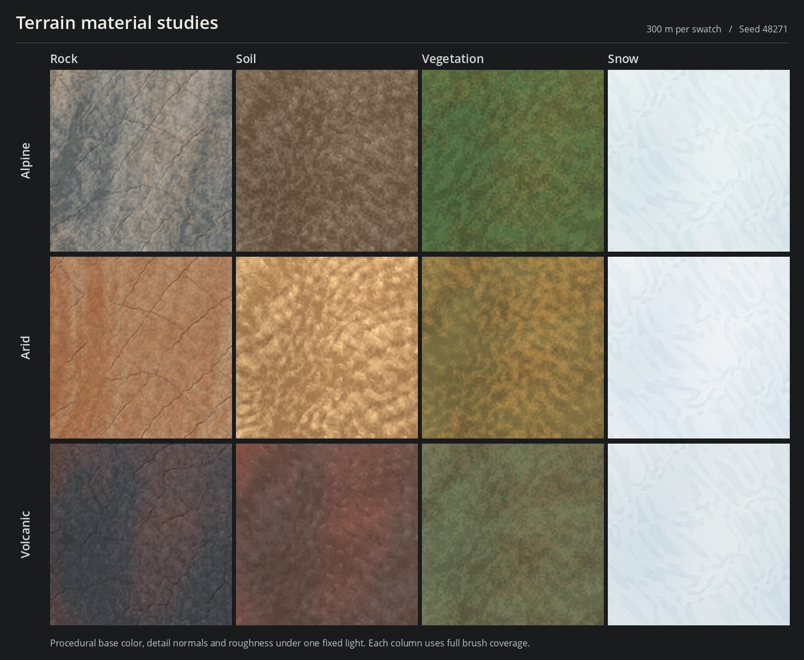
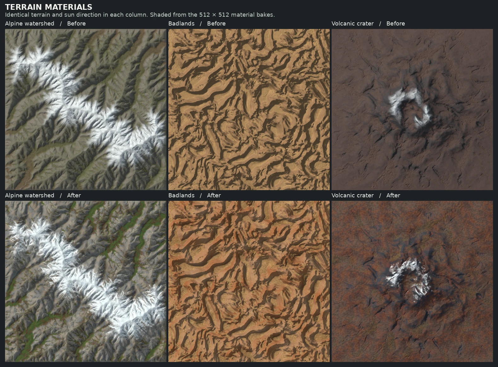
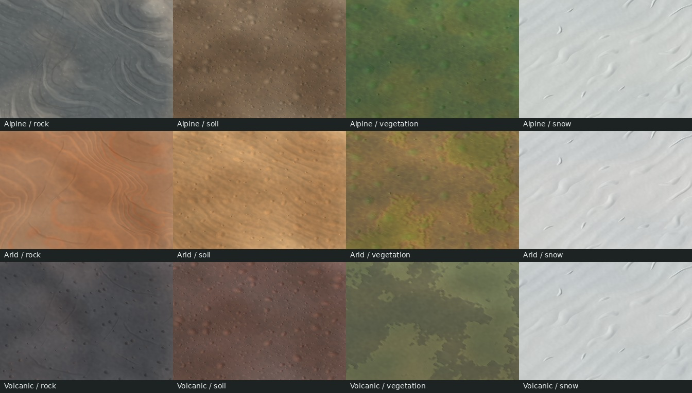

# Terrain material studio

Normal Height generates four paintable substrates from the terrain and erosion fields. The generator uses a seeded spatial model for each substrate and the selected biome. It bakes color, roughness, relief, normals, ambient occlusion and layer coverage on the same grid.

Each swatch covers 300 m. The specimens use the generated base color, detail normals and roughness under a fixed light.

## Paint a surface

1. Build a terrain and select **Paint** in the viewport toolbar. Pick **Rock**, **Soil**, **Vegetation** or **Snow**.
2. Drag on the terrain in 3D or the 2D map. The outer ring shows the radius and the inner ring shows the full-strength area. **Strength** sets the maximum effect of one stroke. **Hardness** sets how far the full-strength area extends.
3. Choose **Erase** to reveal the procedurally assigned material. Undo and redo operate on whole gestures. Escape cancels an active gesture. In the 2D map, the arrow keys move the cursor and Enter applies a dab.
4. **Layer color** edits the selected substrate across the terrain. In **Scene → PBR material studio**, edit the four **Layer albedo** swatches, biome, moisture, bedding, fracture spacing and relief. The brush places each substrate with its full surface response. Existing strokes follow subsequent material edits.
5. Inspect layer coverage, material normals and signed relief in **2D map**, save the project, or use **Export maps → Complete PBR material set**. The project stores stroke paths in tile coordinates. Reopening it or baking another resolution replays those paths against the terrain.

## Maps in a PBR ZIP

| Suffix | Encoding / channels | Intended usage |
| --- | --- | --- |
| `-height16.png` | 16-bit grayscale, min/max remapped | Displacement; reconstruct physical meters using JSON metadata |
| `-relief16.png` | 16-bit grayscale | Signed vertical material relief. Decode using `materialRelief.minMeters` and `maxMeters` in metadata. |
| `-basecolor.png` | 8-bit RGBA, sRGB | Unlit albedo without AO or sunlight |
| `-normal-gl.png` | 8-bit RGBA normal, +Y green | Low-resolution/non-displaced flat meshes with terrain + micro normals |
| `-normal-dx.png` | 8-bit RGBA normal, -Y green | DirectX-style tangent map; G = 255 - OpenGL G |
| `-detailnormal-gl.png` | 8-bit RGBA normal, microdetail only | Physically displaced meshes; avoids doubling the large-scale terrain normal |
| `-roughness.png` | 8-bit linear grayscale (stored in RGB) | Standard PBR roughness; wet areas become smoother |
| `-ao.png` | 8-bit linear grayscale (stored in RGB) | Approximate terrain local-horizon/cavity occlusion |
| `-metallic.png` | 8-bit linear black (stored in RGB) | Natural soil, stone, snow, vegetation are non-metals |
| `-orm.png` | R AO, G roughness, B metalness, A 255 | glTF-style packed texture |
| `-splat-rgba.png` | R rock, G soil, B vegetation, A snow; sum 255 | Layer blending / masks for landscape materials |
| `-curvature.png` | 8-bit linear grayscale; ~128 neutral, low concave, high convex | Edge wear / cavity material authoring |
| `-unity-hdrp-mask.png` | R metallic, G AO, B detail mask (full 255), A smoothness | Unity HDRP mask layout |
| `-material-metadata.json` | JSON | Map conventions, scale, physical dimensions and authoring parameters |
| `.nhterrain.json` | JSON | Exact reproducible terrain graph and material settings |

PNG rows begin at the north edge of the tile and continue toward the south; columns increase east/right. Export choices are 256, 512, 768, 1024, and 2048 pixels; device-memory preflight may restrict large PBR bundles. The original normal and diagnostic export options are still supported separately.

**Color spaces:** Source palette colors are decoded to linear reflectance, blended in linear light, then encoded as sRGB once. Set base color to **sRGB** and all other channels to **Non-Color / Linear**. Never apply sRGB conversion to normal, roughness, AO, metallic, height, or weight data. Metallic is zero for the included organic/geological materials.

**Normal maps:** Normal exports use physical terrain dimensions, not viewport exaggeration. The combined normal is appropriate when the 3D mesh lacks the matching displaced geometry. If your mesh already reproduces the heightfield surface normals, use the **detail-normal** instead. DirectX flips only green relative to OpenGL; confirm any engine's tangent-space and UV conventions.

**Weights:** The splat file's alpha is data for snow, **not** transparency. The 2D map visualizer shows an opaque interpretation so that snow weight remains visible.

## Material synthesis

| Substrate | Surface model |
| --- | --- |
| Rock | Alpine gneiss has folded mineral bands and joint sets. Arid sandstone has dipping and cross-bedded layers. Volcanic basalt exposes dark matrix, oxidized mineral patches and cavities. Rock features intersect the terrain at its actual elevation. |
| Soil | Alpine colluvium contains clasts among damp fines. Arid sediment adds wind sorting and ripples. Volcanic deposits mix cinders and ash. |
| Vegetation | Moist ground supports clumped alpine cover, dry sites show grass and litter, and volcanic substrates support patches of lichen. |
| Snow | A seeded wind direction sets the alignment of drifts, scour and crust. Aspect, shelter, local slope and relative elevation govern natural retention. Snow can be painted in every biome. |

The terrain classifier uses slope in meters per meter, aspect, signed multiscale landform, and relative wear and deposition. Snow occupies a fraction of the surface. Exposed rock, soil and plant coverage divide the remaining area. Each paint stroke adds coverage in proportion to its distance falloff, with erasing returning coverage to the procedural field. Quantized splat channels sum to 255 per texel.

The bake mixes reference pigments in linear light and encodes the result as sRGB. It averages squared perceptual roughness as a single-lobe GGX approximation. Combined normals follow the derivatives of terrain elevation plus relief. Detail normals express the combined surface normal in the terrain's east/north tangent frame. Eight azimuths and three physical radii (50, 150 and 425 m) estimate terrain horizons. Integration from each local tangent angle to the sampled horizon gives cosine-weighted sky visibility.

A 512-pixel grid across 8 km has samples about 15.7 m apart. The bake filters features according to that spacing. Zooming in activates additional world-space shading for smaller features. The PNGs contain the detail resolved at their export spacing. Biome colors and the ecological placement model are artist-authored. Physical units describe feature spacing, relief and gradients.

## Validation

Run `npm test`, `npm run build` and `npm run test:e2e`. PBR-specific unit tests verify deterministic output, map alignment, unit length/normal conventions, flat-surface behavior, packed channels, project compatibility, and ZIP content. The full export encoder runs in a separate cancellable Web Worker to avoid blocking the editing interface.

### Live 3D near-field surface detail (display-only)

These flat specimens were rendered with the production terrain shader in OpenGL ES. Grazing light reveals joints, gravel, wind ridges and differences in surface roughness. Each row uses one biome and each column uses one fully painted substrate.

The Scene inspector offers **Live close-up microdetail** (on by default). **Double-click any visible terrain surface in 3D** to refocus orbit controls on that point, then scroll closer; the camera has a 6 m-equivalent near plane (on a nominal 8 km tile) and permits ~138 m targeting distance to actually resolve fine detail. This is a
different job from the downloadable PBR maps: the Worker computes material
coverage, rock exposure, snow, soil, slope and macroscopic texture at the exact
heightfield grid resolution. The **fragment shader** then adds finer shading
only when close enough to see it, without changing or inventing terrain
geometry:

- The entire added signal is sampled in **world-space XYZ meters** at scales
  derived from the authored `detailMeters` control. Coherent 3D noise does not
  stretch on a nearly vertical cliff or drift as the camera moves.
- Four material-specific height/color/roughness responses use the **same
  calculated splat weights** as the 2D material preview. Narrow rock-joint
  recesses, soil grain, heterogeneous vegetation and restrained snow crust
  alter albedo (in linear light), roughness and micro-normals together.
- Screen-space derivatives attenuate frequencies that exceed the pixel
  sampling limit. A camera-distance preflight disables the shader's extra
  work altogether at ordinary full-tile zoom; there is no scene-wide
  high-frequency checkerboard or shimmering.
- The shader modifies the existing **MeshStandardMaterial** BRDF rather than
  replacing its lighting, AO, environment maps, terrain normals or shadows.
  Geometry and 16-bit height exports are unchanged.
- There are still **three GPU PBR textures**. During *preview only*, spare
  channels encode rock/soil in packed AO+roughness B/A and vegetation in the
  detail-normal alpha. Snow = 1 - other three layers. The worker's ordinary
  `splat-rgba` remains independent. **Exported ORM still has metallic=0,
  alpha=255**, and exported detail normals still have alpha=255. Never use
  these specially packed preview images as standard glTF/Unity assets.

**Preview versus export:** Subpixel procedural shading is not baked into
`-basecolor.png`, `-roughness.png` or `-detailnormal-gl.png` at a resolution
that cannot encode it. The export remains a reproducible physically scaled
representation of its requested grid. For equivalent close-up detail in
another renderer, that renderer must evaluate comparable physical-frequency
procedural shaders or use a sufficiently high resolution/streamed material
layer. The on/off control is a local View preference, not part of the
portable terrain project, to avoid changing exported geometry or maps.

### Follow-up QA and preview performance

The 3D PBR preview updates the existing three WebGL DataTexture objects in place when the texture dimensions and color spaces are unchanged. This reduces GPU allocation churn during biome and surface edits. The underlying synthesized RGBA data still comes from the worker and is shared between 2D/3D consumers; the original erosion field is not regenerated.

High-resolution browser acceptance is intentionally split from routine CI: the opt-in PBR workflow performs a **real 2048 × 2048 material ZIP export** with a simulated adequate device-memory hint, decodes the actual 16-bit height and representative RGBA maps, and checks GL/DX normal conventions and channel dimensions. The routine workflow still checks the low-memory **2K rejection before any Worker starts**. A device-memory hint is only a preflight input, **not** a simulated physical RAM limit or a promise of success on every GPU. Performance and peak-RSS profiling on actual low-memory devices remain outstanding.

## Repair notes: material scale, caching and export safety

New badlands and volcano scene presets initialize arid and volcanic procedural materials; other presets initialize alpine. Switching presets starts a new scene with new material defaults, while importing a previously saved project preserves its surface overrides. A legacy project without explicit surface settings is saved with its resolved defaults.

Microdetail frequency is specified in physical meters. Wavelengths that cannot be resolved at the selected grid spacing fade out instead of being silently scaled up. The approximate AO samples at 50 m, 150 m and 425 m, using fractional-pixel interpolation at different resolutions.

Live 2D and 3D PBR previews request the same cached material result from a cancellable Web Worker. A stale worker result is never painted over a more recent change; editing materials does not rerun erosion.

The PBR ZIP memory preflight estimates peak allocations (including temporary PNG/ZIP and worker buffers) against a conservative device-memory budget before running the export terrain simulation; the encoding Worker also enforces it. A 2K request may be rejected on lower-memory or unidentified devices. This is a heuristic, not a guarantee of peak RAM: real-device profiling and streaming 4K/8K exports remain open work.

Export metadata now includes resolved, versioned surface parameters, per-map color spaces and channel semantics, exact OpenGL/DirectX normal orientations, and physical AO sampling radii. The material ZIP includes a reproducible project with the resolved surface values.

## Verified performance/QA improvements (2026-11-10, #10 and #17)

- The terrain's 3D preview now uploads **three PBR textures**, not four: albedo (sRGB), packed AO in red/roughness in green (non-color), and detail-only normals (non-color). Three.js samples the documented AO/red and roughness/green channels from the **same** GPU resource. The full-resolution exported maps and physics data remain unchanged.
- Real accelerated browser profiling uses a GitHub-hosted Apple Silicon macOS runner and asserts that WebGL reports **ANGLE Metal / Apple Paravirtual**, not SwiftShader. In the first verified run, rapid 512² edits measured **66.7 ms maximum frame gap**, and 1024² edits **83.3 ms**. Initial PBR first-render wall times were **2.9 ms** and **11.2 ms** respectively. Worker synthesis took 0.99–1.52 seconds **off the UI thread**. These are CI measurements, not guarantees for every consumer GPU.
- The reproducible fixed-studio-light 512² 3D PBR golden records the actual canvas image and compares an 8 × 6 RGB grid with a versioned reference. The recorded mean and p95 color errors were both **zero** under pinned Chromium/SwiftShader, guarding major changes in terrain shading and texture orientation.
- The positive **2048² full PBR ZIP** test now runs under a verified **2 GiB Linux cgroup memory+swap cap**, rather than a simulated browser memory hint alone. A representative successful run peaked at **1,986,625,536 bytes**, with no OOM or OOM-kill events. A second scenario cancels a 2K export, observes Worker termination, and then verifies a smaller export can succeed under the same cap.
- The large verification jobs are **manual / feature-branch opt-in**, not mandatory for every routine PR. The normal CI still runs TypeScript, unit tests and standard Chromium behavior. Large PBR export failures remain possible on actual hardware with less than this measured memory footprint.
