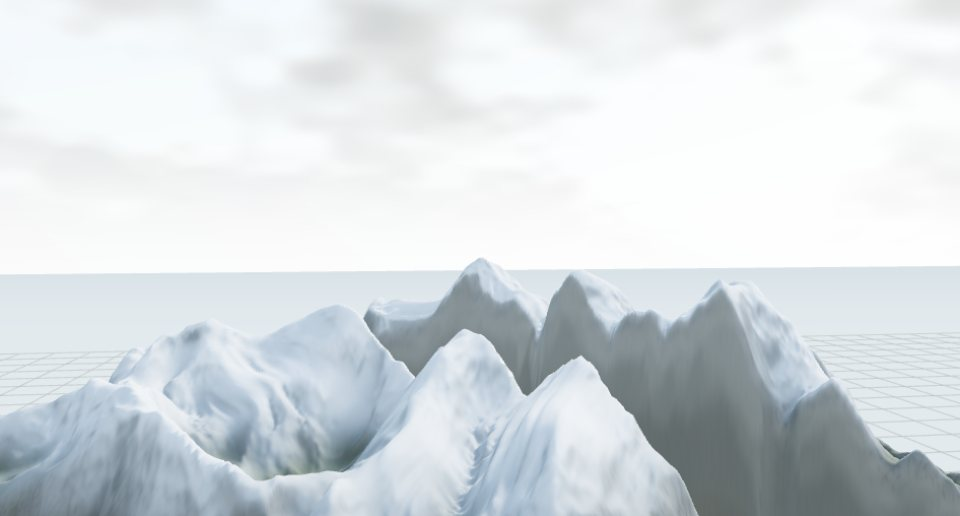
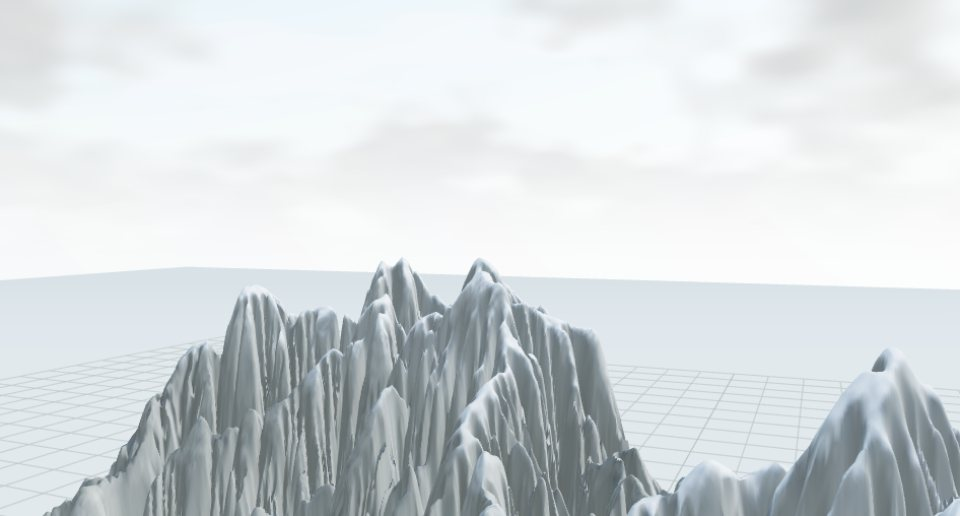
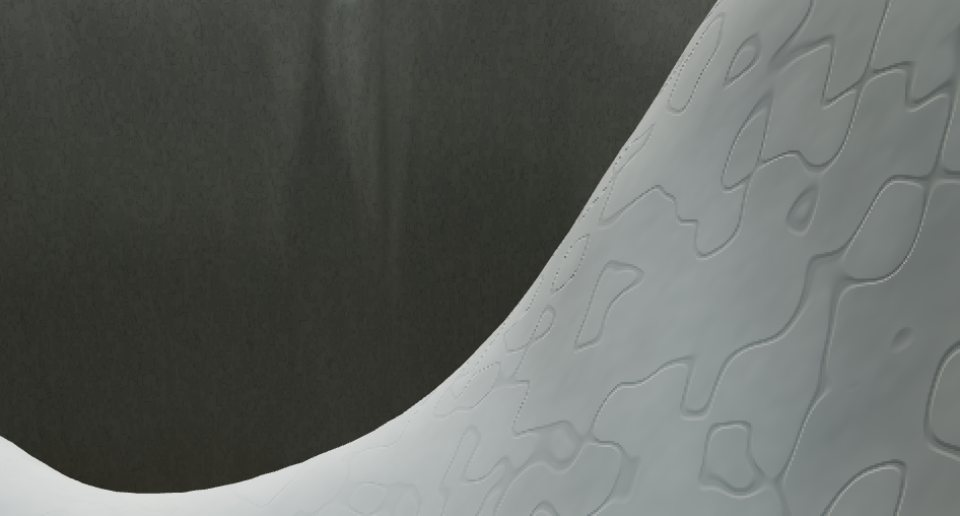
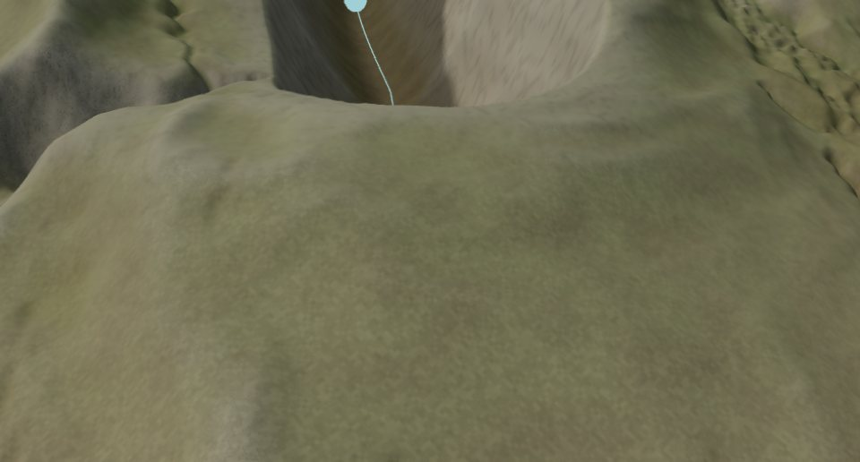
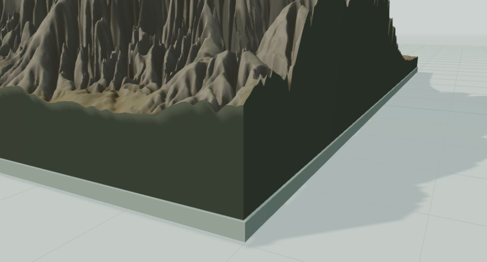
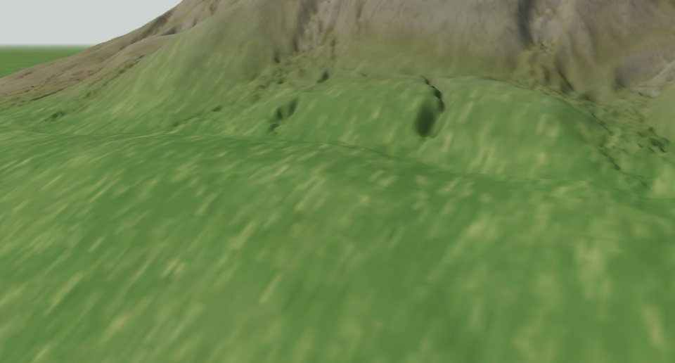

# Adaptive terrain mesh: real-device performance and visual validation

Issue: [#34](https://github.com/dovvnloading/Normal-Height/issues/34). The [adaptive terrain mesh](../src/render/terrainMesh.ts) renders an 8 × 8 tile mesh with bounded per-tile LOD. This document defines a **repeatable hardware acceptance procedure**, not an assertion that CI SwiftShader measurements represent a physical GPU.

## What is now instrumented

- Mesh LOD is **event-driven**. No 300 ms plan recalculation takes place when the camera is motionless. Camera motion triggers a settling/debouncing interval and a bounded mesh plan refresh; auto-rotation is checked periodically. Rebuilds happen only for a changed plan.
- Per-tile **LOD hysteresis** prevents oscillating between resolutions on small camera movements across power-of-two thresholds.
- Camera-driven LOD rebuilds are **sliced across frames**: at most `MESH_SLICE_BUDGET_MS` (4 ms) of main-thread CPU per frame, with the previous mesh left on screen until the new one is complete, so a rebuild never blocks a frame. The sliced result is identical to a one-shot build (unit-tested). Rebuilds caused by a new field, tile scale or mesh-quality change remain synchronous. `data-mesh-build-ms` is the last build's total CPU time, `data-mesh-build-slice-ms` the largest share of it spent in a single frame, and `data-mesh-build-frames` how many frames it took.
- A reproducible `?meshBenchmark=uniform512` reference uses 64 segments per tile (8 × 8), exactly **524,288 triangles**, with the *same interpolation, material shaders and physical normal generation* as `?meshBenchmark=adaptive`. Both start from the same camera transform. This isolates the cost of adaptive geometry topology, rather than pretending the reference is identical to the pre-PR #33 renderer.
- Diagnostic canvas attributes track `data-mesh-plan-checks`, `data-mesh-build-count`, `data-mesh-dispose-count`, `data-mesh-buffer-bytes`, `data-pbr-request-count`, `data-pbr-upload-count`, `data-mesh-plan-ms`, `data-mesh-build-ms`, `data-mesh-render-cpu-ms`, `data-mesh-renderer-geometries`, `data-mesh-renderer-textures`, and benchmark camera position/target.
- An **optional WebGL2 timer query** collects elapsed GPU draw-submission command time when `EXT_disjoint_timer_query_webgl2` is present. Queries are polled asynchronously; invalid/disjoint samples are excluded. If unsupported, the report says *unavailable*—never zero.
- The benchmark collects requestAnimationFrame interval percentiles and the browser's `longtask` entries for orbit, pan, zoom, focus and idle. These are **responsiveness/jank signals**, not a substitute for measured GPU render times.
- Two further opt-in hardware specs share the same config. `npm run test:mesh-lifecycle` repeats cycles of fast zoom/orbit, 3D → 2D → split → 3D switches and PBR material edits. Each cycle it records JS heap and ArrayBuffer memory after a forced GC, live geometries/textures, terrain/PBR worker starts, main-thread long tasks, and the Chrome GPU process's dedicated/shared video memory from the Windows "GPU Process Memory" counters (real VRAM, the same source as Task Manager). `npm run test:mesh-visual` aims captures at the highest ridge against the sky, the steepest cliff, the valley floor, the terrain-skirt seam and the expanded-meadow boundary, plus a 24-step orbit. It locates these on the displayed surface through a benchmark-only `window.__nhMeshBenchmark` hook (camera placement and surface height), and compares each frame before and after LOD refinement to quantify popping. It saves frames, JPEG thumbnails and a video.
- `data-mesh-buffer-bytes` is the distinct underlying CPU-side geometry buffer sizes, **not GPU VRAM**. `renderer.info.memory` counts live geometries/textures but does not provide true VRAM bytes. `performance.memory` may be unavailable on some browsers.

## Run on real hardware

Install Node ≥22.12 and dependencies:

```bash
npm ci
npm run build     # Build once; Playwright reuses dist/ without rebuilding
npx playwright install chromium
# If using MESH_BENCH_CHROME=1 in the examples below, install
# Google Chrome stable on the machine (or: npx playwright install chrome).
```

On an integrated-GPU laptop and a discrete-GPU desktop, run both the optimized and reference cases on exactly the same hardware/browser build, screen resolution, device-pixel ratio and project. Example quick pass:

```bash
MESH_BENCH_CHROME=1 MESH_BENCH_DEVICE="Laptop iGPU / driver version" \
MESH_BENCH_RESOLUTIONS=512 \
MESH_BENCH_QUALITIES=high \
MESH_BENCH_MATERIALS=clay,pbr \
npm run test:mesh-perf
```

For the full matrix requested in issue #34:

```bash
MESH_BENCH_CHROME=1 MESH_BENCH_DEVICE="Desktop dGPU / driver version" \
MESH_BENCH_RESOLUTIONS=128,256,512,1024 \
MESH_BENCH_QUALITIES=balanced,high,ultra \
MESH_BENCH_MATERIALS=clay,pbr \
npm run test:mesh-perf
```

The full matrix is **48 tests** (4 grid sizes × 3 mesh qualities × 2 materials × 2 topologies), so allow hardware-dependent time and disk space. Test both `MESH_BENCH_EXAGGERATION=1` and `MESH_BENCH_EXAGGERATION=1.8` in separate runs. Use `MESH_BENCH_VIDEO=1` for videos and inspect the still captures for ridge silhouettes, nearby gullies, terrain/meadow boundary and zoom jumps.

Each test opens its own visible Chrome window for about 10–25 seconds, so the full matrix takes over the screen for roughly 11 minutes per exaggeration on a desktop GPU. Playwright clears `mesh-benchmark-results/` at the start of every run, so copy `mesh-benchmark-results/summary/` elsewhere before the next run. Summarise one or more summary directories (for example one per exaggeration) into Markdown with:

```bash
npm run report:mesh-perf -- path/to/summary-ex1 path/to/summary-ex1.8 > report.md
```

The report lists every case, compares adaptive against the uniform reference, summarises PBR cold start, and checks the gates below; it exits with status 2 if any case misses them.

Memory/lifetime and visual audits (Chrome, hardware GPU; results land in `mesh-benchmark-results/lifecycle/` and `mesh-benchmark-results/visual/`):

```bash
MESH_BENCH_CHROME=1 MESH_LIFE_RESOLUTIONS=128,256,512,1024 MESH_LIFE_CYCLES=8 \
npm run test:mesh-lifecycle
MESH_BENCH_CHROME=1 MESH_VISUAL_RESOLUTION=1024 MESH_VISUAL_EXAGGERATION=1.8 \
MESH_VISUAL_PRESETS="River-cut highlands,Alpine watershed" npm run test:mesh-visual
```

The lifecycle audit fails on any growth in live geometries or textures, on any terrain-worker rerun, on a PBR re-upload caused by camera motion or view switches, or on a per-cycle trend above 1 MB JS heap, 2 MB ArrayBuffers or 8 MB GPU-process video memory. Video memory is read on Windows only (`null` elsewhere, never estimated).

Hardware is required by default. If the browser reports SwiftShader/llvmpipe or the GPU renderer is hidden, the **hardware-mode test fails** to prevent falsely declaring real GPU validation. Record the device GPU name, driver, OS, browser build, display refresh rate and power mode before comparing.

For a *non-hardware* CI smoke run that only verifies the recording pipeline:

```bash
MESH_BENCH_SOFTWARE=1 MESH_BENCH_HEADLESS=1 \
MESH_BENCH_RESOLUTIONS=128 MESH_BENCH_QUALITIES=balanced \
MESH_BENCH_MATERIALS=clay npm run test:mesh-perf
```

This uses SwiftShader and **must not** be used to approve hardware FPS performance. The normal GitHub CI runs this limited software smoke test; its artifacts are named `terrain-mesh-benchmark-smoke`.

## Evidence and acceptance rubric

Per-test JSON appears in `mesh-benchmark-results/summary/`, with screenshots and optionally video/trace files under `mesh-benchmark-results/`. The test records `rafGapsMs`, `mainThreadLongTasksMs`, optional `gpuDrawTimeMs`, CPU times for plan/build/PBR packing, geometry and texture counts, mesh triangles, and requested/executed PBR uploads.

For each hardware device, compare the **reference** and **adaptive** JSONs at identical viewport/camera configurations, and include:

1. **Responsiveness:** report p50/p95/p99/worst RAF intervals for orbit, pan, zoom, focus, idle; note outliers from thermal throttling. No repeated periodic plan work while the camera is idle.
2. **GPU performance:** report actual timer-query p50/p95/p99/worst **only if supported**, otherwise state "not available." Check for shader-compile and upload stalls separately rather than mislabelling CPU submission as GPU time.
3. **Memory/lifetime:** no cumulative growth of Three.js live geometry/texture counters across repeated camera moves and 3D/2D switches; `meshBuildCount - meshDisposeCount === 1` for the live main terrain; mesh buffer estimates remain below 100 MB even at Ultra. Real VRAM requires an OS GPU profiler.
4. **Visual quality:** visually inspect silhouettes on hard mountain ridges, steep cliffs, river banks, tile seams, expanded-ground transition, and both normal/1.8× exaggeration. No new T-junction holes, normal seams, oscillation, popping, persistent serration or fake elevation changes.
5. **Data fidelity:** worker-generated Float32 field stays identical while only camera/LOD/material view settings change. Source 128² cannot display real sub-sample detail regardless of tessellation.

**Targets** (checked by `npm run report:mesh-perf`): p95 RAF interval ≤ 33.3 ms in every camera phase, no main-thread task > 250 ms, exactly one live terrain mesh, CPU-side geometry buffers < 100 MB, and no PBR re-upload caused by camera motion. Met on the desktop dGPU below for every quality, field size, material and exaggeration; on that device frame pacing is also vsync-locked (p95 ≤ 16.9 ms) with no long tasks at all. A per-test orbit p95 can additionally be gated with `MESH_BENCH_MAX_RAF_P95_MS=33.3`.

## Hardware results

### Desktop dGPU: NVIDIA GeForce RTX 3060 Ti (2026-11-12)

Windows 11 (26200), driver 610.88 (32.0.16.1088), Chrome stable via ANGLE/Direct3D 11, Intel i5-10400F, 1920×1080 at 60 Hz, 1440×1000 viewport at DPR 1. `EXT_disjoint_timer_query_webgl2` was available, so GPU draw times are real timer-query measurements. Full reports: [before](benchmarks/rtx-3060-ti-2026-11-12-before.md) (48 cases at 1×) and [after](benchmarks/rtx-3060-ti-2026-11-12-after.md) (96 cases at 1× and 1.8×).

**Finding.** Before the fix, every camera-driven LOD rebuild ran in one piece on the main thread. At Ultra this took 70–126 ms, so a double-click focus (or the zoom that precedes it) dropped 3–7 frames: 512² and 1024² Ultra missed the 33.3 ms p95 target (66.6–116.7 ms), and 256² Ultra had a 121 ms stall. 14 of 48 cases dropped at least one frame. GPU time was never the problem.

**Fix.** Rebuilds are sliced across frames (above). Separately, the height sampler reads interior source texels directly instead of through bounds-checked closures (identical values, unit-tested against the original implementation): sampling is ~2.7× faster, creating the sampler for a new field is ~8–12× faster (1024²: ~190 → ~16 ms), clay vertex colours are a constant fill instead of a per-vertex sRGB conversion, and the field's min/max is computed once per field rather than on every rebuild.

| Case (1×, adaptive) | Worst frame, before → after (ms) | Worst main-thread task, before → after (ms) | Rebuild CPU, before → after (ms) | Worst single frame of the rebuild (ms) / frames |
|---|--:|--:|--:|--:|
| 256² Ultra clay | 116.7 → 16.8 | 121 → none | 117 → 40 | 8.2 / 9 |
| 256² Ultra PBR | 66.6 → 16.8 | 73 → none | 71 → 35 | 7.2 / 8 |
| 512² Ultra clay | 100.1 → 16.8 | 114 → none | 109 → 45 | 13.3 / 9 |
| 512² Ultra PBR | 66.7 → 16.9 | 80 → none | 75 → 42 | 5.8 / 10 |
| 1024² Ultra clay | 116.7 → 16.9 | 126 → none | 124 → 42 | 6.4 / 10 |
| 1024² Ultra PBR | 116.6 → 16.8 | 118 → none | 116 → 41 | 9.0 / 9 |

After the fix, across all 96 cases (Balanced/High/Ultra × 128²–1024² × clay/PBR × adaptive/uniform × 1×/1.8×):

- **Frame pacing:** p95 RAF interval ≤ 16.9 ms in every phase of every case; no main-thread long task (> 50 ms) anywhere. The only frame ≥ 33 ms was a single 33.4 ms interval in the uniform reference (128² High clay, 1.8×, focus), which performs no rebuild.
- **GPU draw time (p95):** adaptive 1.06–3.41 ms clay and 1.19–4.19 ms PBR, against 3.04–5.97 ms and 4.00–6.91 ms for the 524,288-triangle uniform reference: roughly half the GPU time at matched cameras.
- **Memory/lifetime:** exactly one live terrain mesh after every run, at most 5 live geometries, CPU-side geometry buffers ≤ 12.0 MB adaptive (20.6 MB uniform reference), no PBR re-uploads from camera motion.
- **Synchronous builds** (new field or quality change) are 2–3× faster, e.g. 1024² High 199 → 71 ms and the uniform reference 267 → 109 ms; they still block for that one frame.
- **Visual check:** captured ridge, near-cliff and expanded-ground frames at 1.8× show continuous silhouettes and no cracks, seams or apron gaps. Geometry is bit-identical to the pre-fix build, so tessellation output is unchanged.

#### Memory and lifetime: zoom, 3D/2D/split and PBR edits

Ultra PBR adaptive mesh, 8 cycles per size. Trends are least-squares slopes per cycle from cycle 2 on, taken per phase (after camera, after view switches, after the PBR edit). Video memory is the Chrome GPU process's dedicated usage from the Windows counters; it includes the browser compositor, which accounts for the ±15 MB difference between phases.

| Field | JS heap trend | ArrayBuffer trend | GPU-process VRAM trend | GPU-process VRAM | Live geometries / textures | Terrain-worker reruns | Worst stall: camera / views / PBR edit |
|---|--:|--:|--:|--:|--:|--:|--:|
| 128² | +0.08 MB/cycle | +0.01 MB/cycle | +0.15 MB/cycle | 109–147 MB | constant | 0 | none / none / none |
| 256² | +0.09 | +0.01 | +0.02 | 110–155 MB | constant | 0 | none / none / none |
| 512² | +0.07 | 0.00 | +0.02 | 115–158 MB | constant | 0 | none / none / none |
| 1024² | +0.07 | 0.00 | +0.15 | 128–167 MB | constant | 0 | none / 64 ms once / none |

Each PBR edit caused exactly one PBR request and one upload. Repeated settings reused the cached material variant: two PBR worker starts in total for eight edits. Camera motion and view switches caused no PBR uploads.

This audit found two recurrent main-thread stalls at 1024², both now fixed:

- **PBR material edit: 84–102 ms on every edit → none.** Packing the live-preview ORM/micro-normal textures ran on the main thread (~85 ms at 1024², ~26 ms at 512²). It now runs in the PBR worker and is cached with the maps; main-thread apply cost is 0.4–2.6 ms at every size.
- **Switching to 2D or split: 54–77 ms on every switch → 64 ms on the first switch only.** The 2D map re-rasterized an unchanged field each time it mounted. Up to four finished rasters per field are now reused.

#### PBR cold start

Material synthesis runs off-thread (80 ms at 128² to ~1.2 s at 1024²). The main thread spends 0.4–2.6 ms applying the maps, and the first PBR draw takes 10–17 ms once its shader program exists. The program is compiled once per browser session: the first PBR draw in a fresh browser took 153–193 ms. That is a one-time cost within the 250 ms stall target. See the [final-code PBR report](benchmarks/rtx-3060-ti-2026-11-12-pbr-final.md); Ultra frame pacing there is unchanged (p95 16.8 ms, no long tasks).

#### Visual audit (1024², Ultra, PBR, 1.8× exaggeration)

Views are aimed at features found on the displayed surface. "LOD swap" compares the frame drawn right after the camera move with the frame after the sliced refinement lands. It is the share of pixels whose colour changes by more than 24 levels; a crack, hole or topology jump would show up there.

- **River-cut highlands:** LOD swaps changed 0.1–0.4% of pixels across all five feature views, and at most 0.4% across 24 orbit steps.
- **Alpine watershed:** LOD swaps changed 2.4–5.9% for the long camera jumps between feature views (expected coarse-to-fine refinement after a jump) and at most 1.5% between orbit steps, apart from 4.2% on the jump into the first step.
- **Inspection:** silhouettes against the sky are continuous; the skirt follows the terrain edge without gaps; the meadow boundary blends without seams; no cracks or holes appear on cliffs or valley floors.

| | |
|---|---|
|  |  |
|  |  |
|  |  |

**Targets for this class of device** (desktop dGPU, 60 Hz): p95 frame interval ≤ 16.9 ms in every camera phase, with no main-thread task over 50 ms during camera interaction, PBR edits or repeated view switches. GPU draw p95 ≤ 4.2 ms adaptive at Ultra. CPU-side geometry buffers ≤ 12 MB. Chrome GPU-process video memory ≤ 170 MB at 1024² Ultra PBR, with no growth across cycles (< 8 MB/cycle gate; measured ≤ 0.15 MB/cycle).

Still outstanding for full sign-off: an **integrated GPU** run (this machine's i5-10400F has no iGPU) and, where possible, a representative **mobile** device. The same three commands produce all of the above evidence on them.

## CI versus hardware coverage

- Unit tests cover mesh plan hysteresis, source consistency, seam geometry, buffer accounting and percentile math.
- **Routine push/PR CI is deliberately short**: unit tests and a single TypeScript/production build only. It does not install browsers, run Chromium, or run performance benchmarks.
- Full Chromium, idle-camera stability, geometry disposal, PBR upload checks, and a software-rendered benchmark smoke pair are **opt-in only** via GitHub Actions → **Extended terrain QA (manual only)** → Run workflow. The longer workflow is not a production merge gate unless a reviewer explicitly requests it.
- **Hardware sign-off requires an actual integrated and discrete GPU run**, attaching both matrix outputs and GPU/driver metadata to issue #34. The discrete-GPU run is recorded above; leave the issue open until an integrated-GPU run is added. Successful CI is a software regression gate, not a hardware acceptance certificate.
