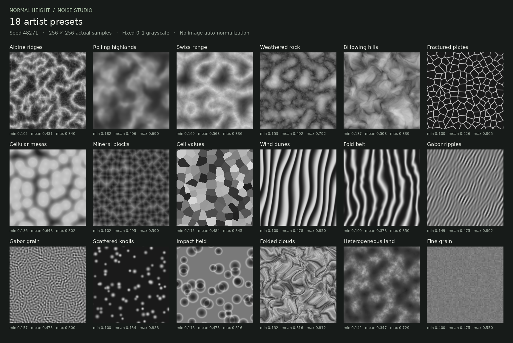
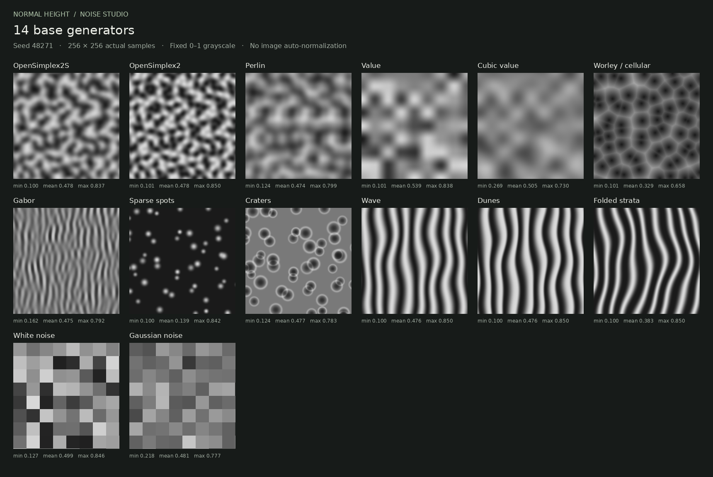

# Noise Studio v3

Noise Studio separates the spatial generator from its fractal structure, seed
policy, domain distortion and output shaping. The same sampler drives the graph,
library thumbnails, seed explorer and source exports. This guide describes the
implemented controls and their practical limits; it does not claim a benchmark
lead over commercial terrain or material tools.

## Start a source

Choose **Nodes → Browse Noise Studio**, search an artist preset or switch to
**Base noises**, select a card and choose **Add noise**. A normal Procedural
noise node also starts in Studio v3. Selecting a card does not change a graph
until it is applied. An existing node's **Noise library** replaces its artistic
controls in one undo step, preserving the main and warp seed choices.

The library contains 18 starting points for terrain, fractures, directional
materials, craters and grain. The Landscapes list adds three complete editable
graphs: Studio ridgelands, Studio wind dunes and Studio impact field.

The inspector's height preview uses a fixed 0–1 display range. The histogram
uses the same range, while the numerical minimum and maximum report actual
values, including values outside that interval. Clipped preview colors do not
mean a Float32 source has been clipped. **Capture A** records the current
settings, project seed and world size; B follows later edits. Both previews use
the same display mapping, so contrast changes remain visible.

## Choose a generator

| Generator | Useful for | Specific controls and behavior |
| --- | --- | --- |
| OpenSimplex2S | Broad terrain and general organic structure | Smoother OpenSimplex2 variant from the pinned FastNoiseLite implementation |
| OpenSimplex2 | General coherent detail | Faster OpenSimplex2 variant; a different seeded kernel from OpenSimplex2S |
| Perlin | Coherent detail and derivative-driven terrain | Analytic base derivatives for Swiss, Jordan and curl operations |
| Value | Soft interpolated random lattice values | Hermite interpolation |
| Cubic Value | Broad, softly varying structure | Cubic interpolation, separately bounded |
| Worley / cellular | Cracks, cells, masks, mineral structures | Seven return modes, three applicable distance metrics, jitter, blending and edge width |
| Gabor | Directional ripples and surface grain | Carrier frequency, Gaussian bandwidth, orientation, spread and impulse density |
| Sparse spots | Local hills, spots and masks | Density, radius and softness |
| Craters | Local depressions with raised rims | Density, radius, softness and rim width |
| Wave | Directional bands | Sine, triangle or sawtooth; phase and seeded phase irregularity |
| Dunes | Asymmetric repeating relief | Crest position controls windward/leeward slope widths |
| Folded strata | Coherent folded bands | Phase, irregularity and independently controllable domain warp |
| White noise | Discrete random cell values | Coordinate-based lattice values; resolution does not reseed the field |
| Gaussian noise | Gaussian-distributed lattice grain | Box–Muller values, clipped at three standard deviations and mapped to the bounded source range |

The Gabor generator is a jittered sparse convolution with random-phase Gaussian
windowed carriers, a smoothly truncated tail, variance scaling and a smooth
range bound. It is an independently implemented adaptation of sparse Gabor
noise, not an exact Poisson impulse process or an analytically filtered Gabor
renderer. White and Gaussian sources are constant within their lattice cells;
choose their frequency or physical feature size to set grain size.

### Cellular choices

**F1** is distance to the nearest feature point and **F2** is distance to the
second nearest. **F2 − F1** is a gap between distances; it is not geometric edge
distance. **F1 / F2** is a ratio. **Cell value** assigns one deterministic random
value to each nearest-point region. **Smooth F1** blends adjacent minima.

**Distance to edge** finds the actual nearest Euclidean Voronoi bisector, then
maps its distance through Edge width. It uses Euclidean geometry regardless of
the stored metric, so the metric selector is hidden for this output. The other
outputs support Euclidean, Manhattan and Chebyshev distances. Cell randomness
zero produces a regular lattice; one allows the point to move throughout its
cell.

Nearest-feature searches use geometric lower bounds and conservative fallback
neighborhoods. Independent tests compare the optimized result against a wider
15×15 reference search, including exact-boundary and maximum-jitter cases.

## Layer structure

The generator and fractal mode are independent choices. Single layer bypasses
layering; fBm adds signed layers; ridged, billow and ping-pong shape each layer
before accumulation. Hybrid and heterogeneous terrain use feedback, while Swiss
and Jordan use derivative-driven structure.

| Control | Effect |
| --- | --- |
| Octaves | 1–12 layers; fractional values fade in the final layer continuously |
| Persistence | Amplitude retained by each finer layer; zero leaves only the first |
| Lacunarity | Frequency multiplier between layers |
| Octave rotation | Rotates successive layers to break repeated axis alignment |
| Weighted strength | Gates later detail by preceding values; zero gives unweighted authored amplitudes |
| Ridge sharpness / rounding / feedback | Crest profile and the amount of detail retained on ridges |
| Ping-pong folds | Repeated triangular folds through the signal range |
| Terrain offset | Shapes the hybrid and heterogeneous recurrences |
| Derivative distortion | Gradient-guided displacement in Swiss and Jordan |
| Detail damping | Jordan's suppression of detail in flat regions relative to steep regions |

Billow and absolute turbulence have the same normalized silhouette when
weighted strength is zero: converting signed billow back to 0–1 is algebraically
equivalent to an absolute-value sum. Bounded feedback can alter that equivalence
when the surviving weights no longer sum to the authored normalization. These names are retained as
recognizable synthesis conventions, not advertised as ten unrelated kernels.

Swiss and Jordan are bounded, shared-control adaptations of the published
recurrences. They are appearances inspired by erosion, not hydraulic simulations.
Perlin supplies analytic base gradients. Other continuous kernels use symmetric
finite-difference estimates. White noise, Gaussian noise, cell-value output and
sawtooth waves disable derivative guidance; the inspector hides the corresponding
controls. Swiss has derivative distortion, while the separate damping control
belongs to Jordan. Actual erosion remains a downstream graph operation.

## Reproducible seeds

The effective seed is displayed as an unsigned 32-bit value. User-entered node
and warp seed inputs accept integers from 0 to 2,147,483,647. A captured seed lock
can represent the complete unsigned range from 0 to 4,294,967,295.

| Setting | Reproducibility contract |
| --- | --- |
| Follow world seed | Combine the project seed, node seed and optional case-sensitive seed name through fixed integer hashing |
| Independent of world seed | Omit the project seed from that combination |
| Lock seed | Capture the currently resolved stream; later project-seed changes do not change it |
| Unlock | Resume the selected linked or independent policy and its stored seed inputs |
| Derived warp seed | Derive a separate stream from the resolved node seed plus the warp offset |
| Independent warp seed | Keep the warp's random stream independent of the node's stream |

The seed name uses UTF-16 FNV-1a followed by the same integer avalanche used by
the stream derivation. Names are case-sensitive; whitespace is meaningful.
Octaves and displacement components use distinct tagged streams. Node IDs,
positions, graph ordering, preview history and worker scheduling do not affect
the random sequence. Duplicating a node reproduces it deliberately; change its
node seed to make a new variation.

**Explore 9 seeds** generates actual candidate maps for the current settings.
Rerolling or selecting candidates does not edit the terrain until **Apply seed**.
Favorites and history capture the settings and a locked resolved seed. They are
bounded at 24 entries each and stored in the current browser. Storage failures
leave the current editing session usable. Export a recipe or source bundle for
a portable record; browser favorites are not part of a terrain project file.

Locking freezes randomness, not the rest of the source. Changing frequency,
world-space feature size, output curve or other artistic settings still changes
the field. A fixed warp seed preserves its noise stream while changes to warp
amplitude and frequency still change the displacement.

## Coordinates and physical scale

**Tile frequency** specifies the number of base lattice features across the
tile. **World feature size** specifies a base wavelength in meters. With world
scaling, enlarging the terrain covers more features at the same physical size.
Separate X/Y scale controls create anisotropy. Rotation follows the axis scales;
translation is expressed in base noise coordinates. The field is centered on
the tile, so world-space comparisons should use positions relative to its center.

Independent, progressive and curl domain distortion each have their own
frequency, amplitude, octave count, persistence and lacunarity. Progressive
distortion feeds displaced coordinates into the next layer. Curl uses a rotated
gradient as its displacement field; it is not a fluid simulation. Warp amplitude
zero is an exact bypass and does not alter the unwarped source.

## Shape the output

The output pipeline applies levels, signed gamma, contrast, bias, inversion,
the custom remap curve, and finally amplitude and elevation offset. Gamma above
one lifts midtones. Black and white points remain at least 0.01 apart, avoiding
unstable amplification when gamma is strong. With clamping enabled, levels and
the shaped signal stay in 0–1 before amplitude and offset; amplitude and offset
can intentionally place the final source outside 0–1.

The curve supports 2–16 points. Input positions increase from zero to one;
output positions may rise or fall. Drag points, double-click to add one, use
arrow keys for precise changes, or edit the selected coordinates. Shift changes
the keyboard increment. The curve uses piecewise linear interpolation, matching
the editor's polyline. With clamping disabled, the endpoint segments extrapolate
outside the curve domain and signed gamma preserves negative values. A final
Float32 safety bound prevents non-finite storage.

## Sampling and seamless blending

Filtered sampling attenuates unresolved detail using the pixel footprint, axis
scales, a local estimate of external warp expansion and the generator's nominal
bandwidth. Authored amplitude normalization stays fixed; removing fine detail
does not enlarge surviving coarse layers. Folded and nonlinear modes approach
estimated shaped means rather than incorrectly folding a zero mean.

Narrow cellular borders use a local one-dimensional box-coverage calculation.
Sparse spots broaden with footprint while preserving their kernel integral and
second moment. Crater bowls and rims use local coverage approximations. These
reduce disappearing or flickering narrow features without claiming exact
integration of every curved cell junction or overlapping feature.

The optional quality levels use 4 or 16 deterministic subpixel samples and
average the **shaped** outputs. This also helps narrow edges and nonlinear curves.
The unfiltered mode is a diagnostic reference. Higher output resolutions can
resolve additional fine detail, so filtered values need not be byte-identical
across different pixel footprints. Point samples at the same coordinates and
settings remain the same.

Filtering is approximate. Sharp cell borders, sawtooth discontinuities,
aggressive remaps and internal derivative feedback can still contain unresolved
harmonics. A finite supersampling grid is not a guarantee of alias-free results.

**Seamless blend** combines four translated evaluations of the complete field
with quintic weights. Opposite values match, including at exported endpoints.
For differentiable sources, opposite derivatives match as well. Hard generators
and piecewise linear curves retain their intrinsic discontinuities. Blending
changes the interior distribution and costs four field evaluations; it is not a
native periodic kernel or a 4D torus mapping. Downstream erosion and other
nonperiodic processors do not inherit a guarantee of seamless final terrain.

## Export a source up to 8K

Open **Export source** on a Studio node. The export runs in a dedicated,
cancellable worker and evaluates the requested resolution directly.

| Format | Values and reconstruction |
| --- | --- |
| 16-bit PNG | Two passes: measure actual Float32 min/max, then map them to 0–65535. Decode with the range in `metadata.json`; constant maps decode to their single value. |
| Float32 RAW | Headerless little-endian row-major scalar values, including negative or above-one values; no range normalization. |

Each ZIP includes `source.nhnoise.json` and `metadata.json`, recording the engine
version, project seed, resolved seed, world size, vertical scale, resolution, sample spacing,
orientation and decoding formula. Values include the source's amplitude and
offset but are **not meters**; multiply by the receiving project's elevation
scale when physical heights are required. The full terrain Export command still
produces physical terrain elevations and includes downstream graph processing.

The bundled recipe captures a locked resolved seed, so importing it into a
different project preserves the random stream. Unlocking resumes the source's
stored seed policy and inputs. The metadata also records the source's original
lock state; world-scaled features still need the recorded world extent.

Samples include both tile endpoints. North is the first row and X increases to
the right/east. For texture tools that expect unique periodic texels rather than
duplicated endpoints, account for that convention when importing.

The encoder normally uses 16 rows at a time. At 8K, its raw pixel strip is about
0.25 MiB for PNG16 or 0.5 MiB for Float32, plus bounded sampler/compressor state.
The completed file still occupies memory: an uncompressed 8K Float32 map alone
is 256 MiB, and browser Blob assembly may temporarily duplicate the archive.
PNG requires two sampling passes; seamless blend and 16-sample quality
multiply generation cost. Small-memory browsers limit this export to 4K.

## Saved projects and recipes

Unversioned noise nodes load as `legacy`; existing `v2` nodes retain v2. The
original noise implementation is kept intact, including its use by mountain,
material and erosion generators. A 96-map reference fixture, captured before
Studio integration, checks all old families across seeds and resolutions.

**Upgrade to Studio** maps the closest settings and changes the algorithm
explicitly. It changes the appearance; Undo restores the original. The classic
noise list still creates v2 nodes for projects that require those patterns.

Recipes are bounded, validated versioned JSON. Invalid enum values, fractional
seeds, malformed curves and unstable levels are rejected before application.
Copying a world-linked recipe preserves its policy, so the receiving project's
seed contributes to the result. Lock before copying to preserve the exact random
stream. World-size-dependent coordinates still require the same world extent;
source bundles record that context explicitly.

## Verification and measurement

The local validation run on 2026-11-24 passed **349 routine tests** and the
production TypeScript/Vite build. The opt-in report also completed its real
8192² PNG export. The 108 dedicated engine tests include independent cellular
and derivative-recurrence oracles; export tests independently decode the PNG,
check quantization bounds and compare RAW values against full-field generation.

### Recorded CPU performance

One worker, AMD EPYC 9V74, Node v24.22.3, three runs per case. These are generation
medians using the shipped preset controls and filtered quality, without
supersampling. They do not include browser rendering, graph erosion or download
time. Maximum timings and all sampling settings are in
[NOISE_STUDIO_BENCHMARK.json](NOISE_STUDIO_BENCHMARK.json).

| Preset | 128² | 512² | 1024² |
| --- | ---: | ---: | ---: |
| Alpine ridges | 19 ms | 316 ms | 1,195 ms |
| Weathered rock | 17 ms | 356 ms | 1,401 ms |
| Fractured plates | 24 ms | 368 ms | 1,405 ms |
| Gabor ripples | 42 ms | 533 ms | 2,103 ms |

A single-layer Perlin **8192² PNG16 + recipe + metadata** export took **27.267 s**
and emitted **34,516,224 bytes**. The largest ZIP output chunk was 72,571 bytes.
The measurement drains encoded chunks to a counter rather than assembling a
browser Blob, so it demonstrates full generation/encoding and bounded producer
buffers, not total browser delivery memory. Complex fractals, seamless blending,
Gabor and supersampling can cost substantially more than this export case.

### Real sampler galleries

The following grids use the recorded seed and raw 256² Float32 buffers at a
fixed 0–1 grayscale. Each panel reports actual minimum, mean and maximum values.
They are source visual checks, not screenshots of the user interface.





Routine validation is `npm test` followed by `npm run build`. The targeted
Playwright acceptance file is `tests/e2e/noise-studio.spec.ts`; the repository's
procedural-noise QA workflow runs it alongside the old-version controls test.
It checks real worker-generated previews, staged application and cancellation,
atomic undo, seed locking, favorites, curve editing, recipe errors and source
export download/cancellation.

Run the optional CPU measurements and gallery data generation with:

```bash
NOISE_STUDIO_REPORT=1 NOISE_STUDIO_REPORT_DIR="$PWD/bench-runs/noise-studio" \
  npm test -- tests/noise-studio-report.test.ts
```

With NumPy and Pillow installed, regenerate the figures using:

```bash
python scripts/render-noise-gallery.py "$PWD/bench-runs/noise-studio" docs/images
```

This records runtime, CPU, three-run medians and maximums for representative
presets, and a real 8192² two-pass PNG export with output byte/chunk counts.
Results describe one runtime and device; they are not GPU benchmarks or timing
guarantees. The renderer and exporter currently use the CPU reference sampler.
GPU/WASM acceleration, exact analytical filtering of the complete nonlinear
pipeline and native periodic kernels remain separate future work.

Algorithm provenance and independent numerical checks are documented in
[NOISE_RESEARCH.md](NOISE_RESEARCH.md). The pinned FastNoiseLite source and license
are retained with the implementation.
