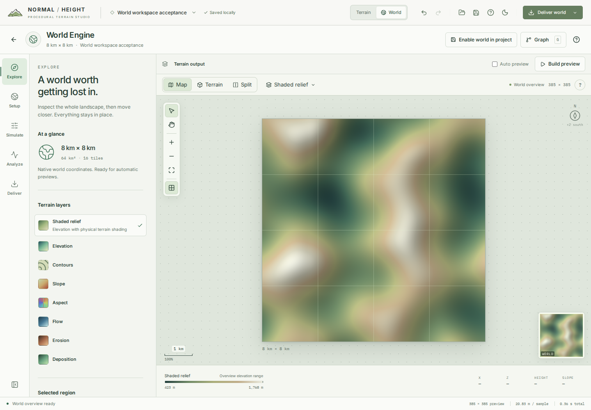
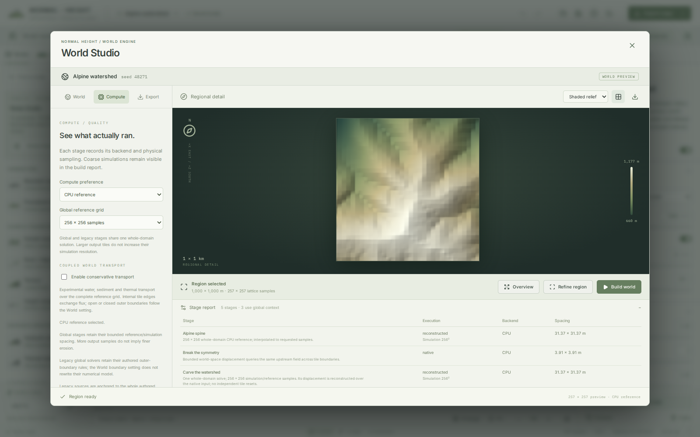
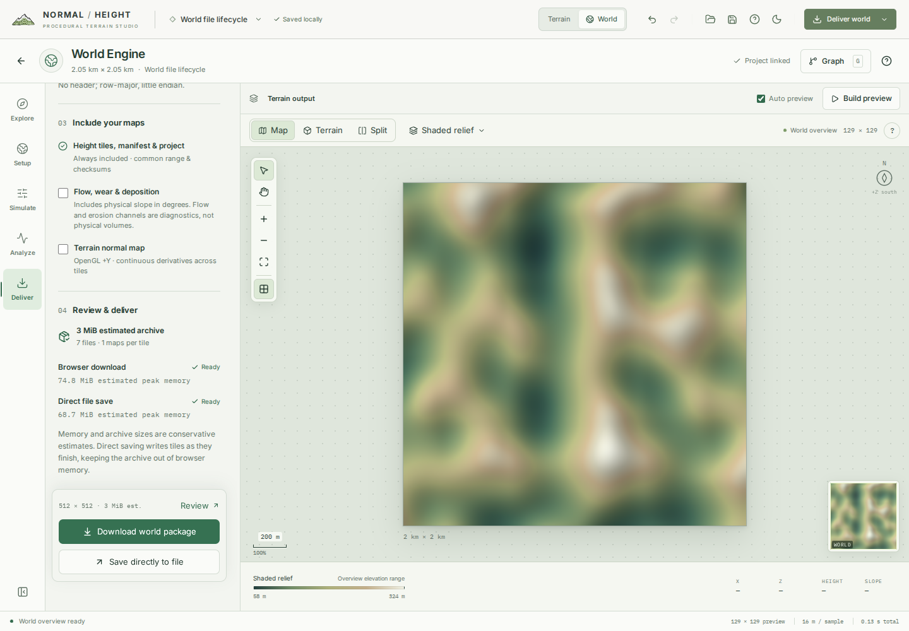

# World Engine implementation and verification

World Studio is the working implementation following [RFC #62](WORLD_ENGINE_PLAN.md).
It preserves the original single-tile studio and adds a distinct World workflow.
The release is an engineering preview: implemented capabilities are listed here
separately from hardware and production-import qualification that still needs
external evidence.

## Using the studio

1. Open any landscape and choose **World Studio** in the workspace toolbar.
2. Set width/depth, local east/south origin, vertical scale and datum. Dimensions
   and elevations use meters. Sample counts are intervals plus one: 1024
   intervals contain 1025 vertex samples.
3. Choose a tile interval size and **Build world**. The overview is deliberately
   bounded; it does not allocate the entire logical grid.
4. Click one tile, drag across several, or use arrow keys to select a region.
   **Refine region** (or Enter on the map) samples that region independently.
   Use **Overview** to return. Height, shaded relief, flow, wear and deposition
   display the generated data.
5. Inspect **Compute** and the expandable stage report. Global reference grids
   and numerical backend choices are recorded explicitly.
6. **Enable World project / Save world setup** writes the opt-in World v2
   configuration into the ordinary project history. Undo restores the prior
   project. A portable project contains the original graph and the World domain.
7. Under **Export**, select the whole world or the current region, a format and
   exact output sample count. Additional diagnostic, normal and authored mask
   maps share the same coordinates. Download a bounded archive or use
   **Save directly to file** where the File System Access API is available.



### Two evaluations, with explicit roles

The existing 3D/2D terrain workspace still uses its original square grid and
versioned node algorithms. Saving a World domain does not silently reinterpret
that legacy viewport. World Studio's overview, regional previews, optional
transport and world export use the new spatial contract. Returning to the
original editor remains useful for shaping the graph and materials.

Version-1 projects remain version 1 until the explicit World save action. Old
noise nodes retain legacy/v2 sampling. Moving nodes, editing labels, opening a
panel, changing theme or selecting display settings does not alter numerical
input identities.

## Spatial and numerical contracts

The coordinate system is local Cartesian: +X east, +Z south, row zero north.
World origin, dimensions, vertical datum and scales are finite validated values.
The logical domain supports up to 32768 intervals per axis without a monolithic
allocation. This is a domain limit, not a claim of qualified 32K exports.

Adjacent tiles use the same global integer sample indices. Partial edge tiles
are cropped, not padded or resized. Exact 4096/8192-sample export grids have
4095/8191 intervals; they are never silently changed to 4097/8193 samples.
Export regrids retain a canonical integer numerator so independent strips and
tiles compute identical shared positions. Halo sampling uses that same grid.

Noise Studio v3 uses world coordinates. Meter-scaled noise preserves physical
feature size. Tile-frequency coordinates refer to the entire authored world,
not each internal tile. Node IDs, tile order and selected region do not reseed
the field. Periodic native source sampling is explicit. Anti-alias filtering
depends on the requested sample footprint; coincident samples at different
filtered levels can intentionally differ. Point-sampled coincident positions
remain identical.

Native pointwise/local stages include Studio noise, blend, remap, terrace,
height/slope masks and bounded warp. Slope and warp query upstream context across
internal tile boundaries. Legacy mountains/noise are evaluated once over the
authored domain. Hydraulic, thermal and spline operations use one bounded
whole-domain reference; the solver displacement is reconstructed over the
native incoming field. They never independently erode each output tile.

Legacy global solvers currently require square physical domains and retain
their original boundary rules. The application refuses rectangular legacy
graphs and periodic global simulations with an actionable error. Native
rectangular graphs and the new rectangular transport reference are supported.



## Persistent CPU computation

`engine/plan/graph.ts` compiles reachable nodes and typed input routes, validates
cycles and ports, and records dependencies/consumers. The original evaluator's
numerics remain intact. Cache identities include semantic node settings, path,
bypass behavior, selected input channels, upstream content identities, seed,
physical scale and requested resolution. Layout, labels and connection IDs
are excluded. Unconnected experiments are not scheduled.

The worker owns immutable cached arrays. Returned snapshots are independent
copies, including shared-channel alias preservation. Transferring a result
cannot detach cached data. Byte accounting counts each backing buffer once.
LRU admission uses the headroom left by the existing 512 MiB graph working-set
preflight, with a 192 MiB maximum cache. Those are allocation policies, not
guarantees about total browser process memory.

An idle worker survives completed builds, ordinary edits and preview changes.
Starting a replacement while a synchronous legacy solver is busy terminates
that worker. Cancel/unmount clears pending timers and prevents stale epochs
from publishing. A result that becomes outdated during the auto-build debounce
cannot replace the displayed field. The last complete terrain is retained.

The diagnostics panel reports hits/misses, node timings, cache bytes, estimated
working bytes and evictions. Clear cache releases computation storage while
retaining the displayed result. Reports are downloadable JSON.

## Optional local region storage

**Remember completed CPU regions** enables a separate 64 MiB cache in
`normal-height.world-cache`. It is off by default and is rebuildable data,
separate from authored projects and any future imported raster store.

Entries contain complete independently owned fields, spatial/stage metadata,
schema version and CRC32. Reads validate dimensions, finite values, version,
size and checksum. Invalid entries become misses. Admission and LRU eviction
occur in one IndexedDB transaction, including when multiple tabs compete.
Denied storage and quota failures fall back to bounded memory. GPU/Auto results
are not ambiguously served from the CPU disk cache. The UI exposes actual
storage backend/usage and a clear-region-cache action.

## WebGPU scope

World remap, terrace, blend and height-mask kernels have real WGSL compute
implementations and an explicitly rounded CPU f32 oracle. Every created GPU
backend runs numerical vectors before it can be selected. Capability checks
cover secure context, adapter/device availability, buffer/binding limits,
workgroup/dispatch limits, shader errors and device loss.

CPU reference remains the default. Auto/WebGPU requests may fall back before a
build, with the reason reported. A lost device aborts the current build instead
of mixing CPU/GPU numerical implementations across adjacent output tiles.
Global solvers, legacy noise and GPU-ineligible spatial dependencies remain
CPU stages. GPU-to-WebGL display integration is not a renderer rewrite.

`scripts/world-gpu-qualify.mjs` records runtime qualification and an end-to-end
graph comparison. CI explicitly uses a software adapter. Software results are
numerical/fallback evidence, not proof of hardware acceleration or speedup.
An integrated-GPU/discrete-GPU device matrix, transfer costs and device-loss
hardware evidence remain release gates.

## Coupled world transport

See [World transport equations, validation and CPU evidence](WORLD_HYDROLOGY.md)
for the numerical contract and reproducible open/closed-domain measurements.

**Enable conservative transport** adds an optional, versioned post-graph stage.
It uses a bounded global reference grid with physical rectangular sample
spacing, deterministic priority-flood drainage and synchronized water/sediment
face exchange. Interior faces are processed once with opposite signed updates;
tile traversal/partition size does not change the result. Open/closed outer
boundaries are explicit; periodic transport is rejected.

The model includes rainfall, evaporation, available-water limiting, finite
erodible cover, sediment transport/deposition and conservative thermal movement.
Boundary samples have half/quarter control areas, so duplicate tile borders
do not inflate total volume. Its result is reconstructed over the original
native detail using one global displacement field. Authored mask branches are
evaluated before post-graph transport; scalar weights are never eroded as
physical elevations.

The UI and manifest retain independent water and solid ledgers: rainfall,
evaporation, boundary export, final water, erosion, deposition, suspended
sediment, thermal movement and numerical residuals. These measure the coarse
simulation before fine-grid reconstruction. The model is experimental artistic
terrain processing. It is not calibrated geophysics, a native 8K fluid solve,
or a proven multirate coarse/fine coupling scheme.

## Export packages



The exporter samples and encodes bounded tiles and streams ZIP chunks with
consumer acknowledgments. File saves apply backpressure after each write.
In-memory downloads account for the retained archive and Blob/copy overhead;
the UI additionally limits retained download bytes. Oversized requests are
refused before field generation, with a streaming-file/smaller-region remedy.

All height tiles share one output-region elevation range. Float32 RAW contains
physical elevation in meters. PNG16/UInt16 RAW use one documented linear
encoding. Diagnostic ranges are common across the region; named masks retain
fixed 0–1 weights. Normals/slope use the required neighboring samples, including
at internal tile and selected-region edges. The package contains checksummed
maps, a portable project and a versioned manifest with exact sample counts,
intervals, origins, spacing, axis order, encoding, backend, stage versions,
native/reconstructed classification and conservation data.

Unreal profiles enforce supported landscape dimensions and shared quantized
vertical transforms. Unity profiles use power-of-two interval tiles and
little-endian UInt16 RAW. Both include import guidance and are explicitly
experimental until verified in real editors. Full world PBR baking, OpenEXR,
GeoTIFF/CRS export and additional production profiles are not claimed.

The manifest also records the source Git revision and whether the build tree
was modified. Builds outside Git state `unknown`; no revision is invented.
Periodic normal and slope maps sample wrapped neighbors at the true world edge,
including regional grids whose spacing does not divide the world period.

## Evidence and measured limits

The pinned starting point is `0906f95f064eda8b27ed4098364eb6d3e214476d`.
Its routine suite passed 349 tests. The implementation preserves 96 stored
legacy/v2 reference hashes and the older independent 48 reference cases from
`d3364db4a3e1ce81a1c9f08c8523e178219f0250`.

| Recorded CPU fixture               | Result                                   | Scope                                                              |
| ---------------------------------- | ---------------------------------------- | ------------------------------------------------------------------ |
| Alpine 512², unchanged rebuild     | 20.4 ms median                           | Three Node evaluator repeats, including snapshots/thumbnails       |
| Alpine 512², downstream remap edit | 18.2 ms cached versus 4593.3 ms uncached | Exact output equivalence; 99.60% improvement on this fixture       |
| Native 4096² graph → PNG package   | 33.00 s, 13,675,701 bytes                | 256 independently decoded tiles; 123,330 exact border comparisons  |
| Native 8192² graph → PNG package   | 148.25 s, 32,289,835 bytes               | 1024 independently decoded tiles; 509,826 exact border comparisons |

Measurements used Node 24.22.3 on an AMD EPYC 9V74 host. They exclude browser
rendering and are not general performance guarantees. Export process RSS
peaked at approximately 473 MiB and 543 MiB; the Node/Vite process includes
compiler/runtime and verification allocations. Estimated live working arrays
and total process RSS are different measures. Constrained-device and total-process memory, repeated input/cancellation
latencies, and hardware performance still need separate profiling. The
single-run Chromium export measurements below address a narrower scope.

### Actual Chromium 4K / 8K export

A separate opt-in run used Headless Chromium 158.0.8127.18 on a Xeon 6975P-C
runner, with the editor in 2D mode and the CPU reference selected. It exported
native Perlin → remap → terrace → output through the real World Studio button,
production worker, ACK/backpressure, Blob publication and completed download.
The application build was clean revision `4e0c8cb08ca0531083336016150d748e9098451e`.

| Output samples | Download complete | Independently decoded tiles | Exact shared-border comparisons | 25 ms timer p95 / maximum gap |
| -------------- | ----------------: | --------------------------: | ------------------------------: | ----------------------------: |
| 4096²          |            86.9 s |                         256 |                         123,330 |                25.6 / 40.1 ms |
| 8192²          |           345.1 s |                       1,024 |                         509,826 |                25.2 / 54.0 ms |

The 8K archive contained 67,108,864 unique samples and all 65,536 UInt16 codes.
Cancelling a preceding 8K export showed its cancelled status after 46.0 ms;
the complete preview hash was unchanged and no stale download appeared during
the two subsequent exports. Timer gaps measure main-thread scheduling in this
fixture, rather than direct input latency. These are single runs, height PNG16
only, without global erosion, transport, masks, normals or a file-picker sink.
`performance.memory` returned quantized renderer-heap observations and does not
establish total browser, worker or GPU peak memory.

[Full browser report](benchmarks/world-engine-browser-export.json) ·
[successful browser profile run](https://github.com/dovvnloading/Normal-Height/actions/runs/45508227581).

### Actual software WebGPU numerics

The WGSL kernels compiled and executed on Chromium's `google / swiftshader`
adapter. The runtime probe compared 2,056 results across remap, terrace, five
blend modes and a height mask: maximum absolute error **2.38 × 10⁻⁷**, RMSE
**2.04 × 10⁻⁸** against the rounded CPU oracle. A 257² noise → remap → output
graph ran its remap on WebGPU, with maximum error **1.79 × 10⁻⁷** and RMSE
**6.69 × 10⁻⁸** versus the CPU graph. Both satisfy the declared 1e-4 maximum /
1e-5 RMSE thresholds. This is real shader execution and numerical evidence on
a software adapter. It establishes no hardware acceleration or speedup.

[Software WebGPU report and source attribution](benchmarks/world-gpu-swiftshader.json).

Raw evidence: [CPU cache](benchmarks/world-engine-cpu.json),
[full graph exports](benchmarks/world-engine-cpu-export.json), and the
`world-engine-evidence` GitHub Actions artifact. Tests cover seeded DAG mutations,
field ownership/transfer, cache eviction, stale epochs, rectangular/odd/partial
tiles, order-independent borders, ROI/halo equivalence, global reconstruction,
independent PNG decoding, masks, cancellation, conservation and project
round trips. Browser acceptance exercises production workers, downloads and
real IndexedDB reopen/corruption paths.

### Reproduce

```bash
npm ci
npm test
npm run build
npx playwright install --with-deps chromium
npx playwright test tests/e2e/world*.spec.ts
node scripts/world-export-profile.mjs 4096,8192 ../world-engine-exports
WORLD_ENGINE_PROFILE=1 npx vitest run tests/compute-cache-profile.test.ts
```

The opt-in **World 4K and 8K browser profiling** workflow exercises real World
Studio downloads, independently decodes the ZIP and every PNG, checks shared
borders and records browser timings, main-thread heartbeat gaps and available
heap observations. It uses the 2D editor view and CPU reference; these samples
are not total-process memory or hardware GPU measurements. Run it manually or
add the `world-browser-profile` label to an implementation PR. It is excluded
from ordinary browser acceptance unless explicitly enabled:

```bash
WORLD_BROWSER_PROFILE=1 npx playwright test tests/e2e/world-highres.spec.ts --workers=1 --retries=0
```

See each benchmark script for output-path/environment options. Visual captures
and their source revision/browser are documented in [MEDIA.md](MEDIA.md).

## Remaining RFC work

The implementation covers a useful CPU-first foundation, selected GPU kernels,
bounded high-resolution graph output and a conservative global transport
reference. It does not certify every RFC release gate. PR #42's older
raster/coast/session work requires a targeted rebase over Noise Studio v3;
its tree must not replace current main. Its authored raster store must remain
separate from rebuildable world cache data, and imported content will need
explicit cache-key/byte-accounting integration.

Production imports, full World PBR exports, broader GPU coverage and real
hardware benchmarks, spatially adaptive multiresolution transport, qualified
32K packages, advanced geology, ecosystem/cinematic tools and GIS are separate
follow-ups. The application and documentation avoid implying they have shipped.
