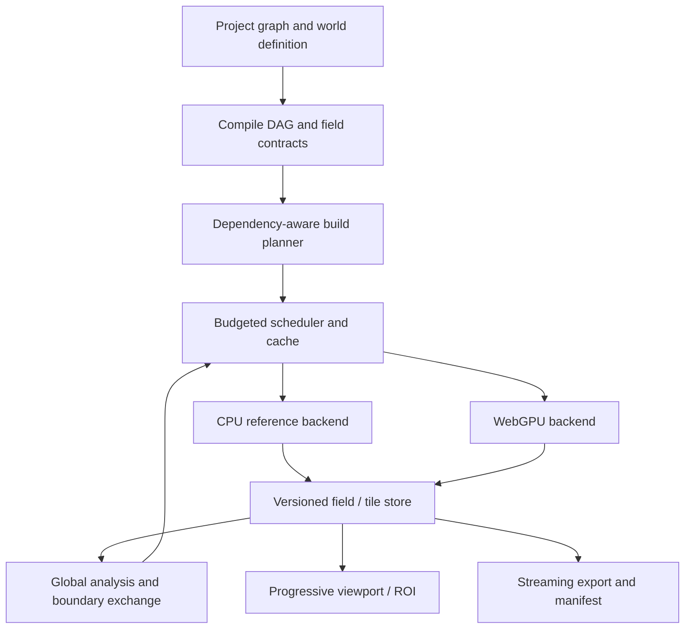

# Normal Height — World Engine 1.0

> Historical planning reference from PR #62. The implementation and verified boundaries are documented in [World Engine](WORLD_ENGINE.md), [World transport](WORLD_HYDROLOGY.md), and [PR #63](https://github.com/dovvnloading/Normal-Height/pull/63). The original release gates below remain useful; this RFC is not a claim that every gate has passed.

**Status:** Historical technical roadmap, reconciled with the merged engineering preview. The proposed targets below do not certify a World Engine 1.0 release.

**Original baseline:** `0906f95f064eda8b27ed4098364eb6d3e214476d` (Noise Studio v3, PR #61).

**Scope:** Browser-native, GPU-accelerated, multiresolution, tile-aware terrain authoring with a deterministic CPU reference backend.

**Original decision requested:** Agree to the architecture and phased acceptance gates before opening implementation PRs.

### Reconciliation snapshot — November 25, 2026

[PR #63](https://github.com/dovvnloading/Normal-Height/pull/63) merged the World Engine engineering preview and this roadmap into `main`. [PR #42](https://github.com/dovvnloading/Normal-Height/pull/42) subsequently merged imported rasters, coastal shaping, named-mask output nodes, water presentation and session/raster history for the single-domain Terrain workspace. World tiles still reject the `heightImport`, `coast` and `maskOutput` node types; extending those shared contracts into World evaluation remains follow-up work.

This reconciliation was checked against `main` at `6fa0573a529d2444f18df365bb1cd7d8856ec007`. The baseline observations, proposed architecture, delivery sequence and unchecked review decisions below retain their historical context. Use the [implementation guide and remaining work](WORLD_ENGINE.md#remaining-rfc-work) for shipped capabilities and outstanding qualification. Merging this documentation does not mark the release gates as passed.

**Implementation update:** World now supports the shared imported-raster sampler,
rectangular whole-domain coastal reference, fixed coastal ports and named mask
outputs. Source-content SHA-256 identities prevent persistent cache collisions
across worker restarts. The snapshot above describes the earlier baseline;
the current contracts and remaining limits are in [WORLD_ENGINE.md](WORLD_ENGINE.md#imported-rasters-coasts-and-named-masks).

## 1. Why this is the next flagship release

Normal Height already generates physically scaled Float32 terrain, supports versioned noise, hydraulic and thermal erosion, spline rivers/ridges, biome-aware materials, PBR map export, camera-adaptive meshes, and atmospheric presentation. Noise Studio v3 brought 14 base generators, 10 layer modes, seed locking, and 8K source-only output. The next limiting factor is not the number of generators; it is the scale and responsiveness of the graph evaluator.

The goal is to move from a single terrain tile to a continuous, editable world with regional computation and production-grade export, without losing reproducibility, physical meaning, or the existing lightweight browser workflow.

### Verified starting point at the original baseline

| Area                  | Behavior at the original baseline                                                 | Consequence                                                                 |
| --------------------- | --------------------------------------------------------------------------------- | --------------------------------------------------------------------------- |
| Working grid          | UI up to 1024 × 1024                                                              | Practical preview limit, separate from mesh resolution                      |
| Full graph            | Evaluator capped at 2048 × 2048; 512 MiB conservative working allocation budget   | Cannot assume 4K/8K by changing a slider                                    |
| Source-only export    | Noise Studio up to 8192 × 8192, strip encoding                                    | Useful precedent; not a full graph export                                   |
| Scheduling            | New terrain worker per build, terminated at completion/cancel                     | Cache cannot survive ordinary edits                                         |
| Dependency evaluation | Per-evaluation node memoization, immutable height arrays across stages            | Reuse exists within a build, not across builds                              |
| World domain          | Version 1 project, square worldSize, square HeightField                           | No independent spatial tile identity, rectangle, or regional build          |
| Simulation            | Several CPU solvers; some operate on a bounded coarse grid and reconstruct detail | Native simulation and resampled output must be distinguished                |
| Materials             | Physical scales, rich channels, separate conservative PBR export preflight        | Full-resolution intermediate arrays and archive retention limit output size |
| Viewport              | Adaptive render mesh and source normals independent of simulation grid            | Preserve the truthful distinction between render LOD and terrain data       |

Repository anchors: [README](../README.md), [graph evaluator](../src/engine/index.ts), [worker lifecycle](../src/hooks/useTerrainEngine.ts), [project types](../src/model/types.ts), [PBR budget](../src/export/budget.ts), [Noise Studio](NOISE_STUDIO.md), [mesh performance](MESH_PERFORMANCE.md).

Noise Studio's 349 routine passing tests, 96 legacy/v2 reference field hashes and five successful PR workflows are a regression baseline ([PR #61](https://github.com/dovvnloading/Normal-Height/pull/61)). The measured 27.267 s 8K single-layer Perlin PNG16 export is not a general terrain performance claim. The older [verification record](VERIFICATION.md) contains a 2K Alpine export measurement, but it predates the present engine; recapture all benchmarks on this pinned baseline before comparing changes.

### Existing work to integrate, not duplicate

At the original baseline review, [PR #42](https://github.com/dovvnloading/Normal-Height/pull/42) was open and not mergeable. It has since merged at `b00418ee7a37ea0428b2bb103493d0b91d91a045`, including imported raster sources, coastal shelf shaping, named mask outputs, water presentation and IndexedDB-backed session/raster history. Raster cache identity and working-memory accounting are integrated into the single-domain Terrain evaluator. World Engine's future import/coast/mask support must reuse those accepted schema, routing and storage contracts rather than create parallel implementations. Keep authored raster/session data separate from rebuildable World cache data; do not imply the merged Terrain nodes already work in World tiles.

## 2. Product experience and release boundary

An artist should be able to:

- Open an existing project with exactly the same CPU result, or create an explicitly versioned World project.
- Set world width/depth, origin, physical sample spacing, vertical scale/datum, and world seed. Navigate an overview, select a region of interest (ROI), and refine it independently of camera mesh quality.
- Work on a graph where changing a downstream node reuses expensive valid upstream work, switching preview ports does not rebuild unrelated branches, undo/redo restores prior results, and cancelled work cannot replace the last valid terrain.
- Choose Auto, CPU reference or supported WebGPU compute. See the actual backend, execution stage, sample resolution, simulation resolution, cache use, memory estimate, and any fallback or approximation. No required GPU or external service.
- Generate a continuous world and export selected tiles, an entire region, or a full terrain graph with aligned height, diagnostic, material and named mask maps, a manifest and the original graph.
- Continue editing while compute and encoding run off the main thread. See progress, cancel, recover from failures and reopen validated cached artifacts.

**1.0 release target:** persistent incremental evaluation, world-space CPU tile infrastructure, a verified GPU path for appropriate kernels, 4K and 8K full-graph export profiles where feasible, globally consistent drainage plus bounded local erosion, and import-tested production packages. A complete graph may contain globally/coarsely evaluated stages; any such stage must be reported with its actual simulation spacing. An 8K output is not automatically an 8K hydraulic simulation. Unsupported operations may run on the CPU or global domain with an explicit cost and capability check, never silently reset at tile boundaries.

**Stretch / subsequent releases:** 16K/32K+ logical tiled worlds, wider GPU coverage, advanced geological processes, Ecosystem Studio (vegetation, scattering and biomes), Hydrology Studio (lakes, rivers, oceans and water meshes), Cinematic Studio (camera paths, volumetrics and rendering), GIS integrations. Do not make these prerequisites for an incremental, useful foundation. Do not claim infinity, voxel/cave support, geological ground truth, or competitive SOTA without evidence.

## 3. Proposed architecture



Maintain separate layers for model/schema, graph planning, execution, spatial fields, storage, simulation, display and export. The existing React/Three.js viewport is not replaced just because compute gains WebGPU. Treat compute-to-WebGL transfer explicitly and measure readback/upload cost. Do not couple graph semantics to GPU implementation details.

### 3.1 Project schema and spatial contract

Introduce an explicit World schema/version (working name v2, unrelated to noiseModel). Keep version-1 parsing, serialization and CPU evaluation compatible. Opening a v1 project must not change its pattern, seed, authored preset, material paint, spline coordinates, bypass, field routing or export appearance. Migration to World mode is an explicit, undoable operation with an explanation that spatial interpretation or newly selected algorithms may change appearance. Preserve original versioned node algorithms; never route a legacy noise node to a GPU approximation by default.

Proposed types (names are design placeholders):

```ts
type Backend = 'cpu-reference' | 'webgpu';
type Scope = 'pointwise' | 'local' | 'global-reduction' | 'global' | 'iterative';
type WorldDomain = {
  originX: number;
  originZ: number; // meters, local Cartesian
  width: number;
  depth: number; // meters
  cellsX: number;
  cellsZ: number; // intervals, not sample counts
  heightScale: number;
  datum: number;
  boundary: 'closed' | 'open' | 'periodic';
};
type TileKey = { level: number; x: number; z: number };
type FieldDescriptor = {
  semantic: string;
  units: string;
  encoding: 'f32';
  domain: WorldDomain;
  tile: TileKey;
  algorithmVersion: string;
  backend: Backend;
};
```

A world of Cx × Cz intervals has (Cx+1) × (Cz+1) vertex samples. Use a canonical global integer sample index (i,j), evaluated at originX+i*dx, originZ+j*dz. Define positive X east, positive Z south; north is the first exported row. Compute in local coordinates relative to an origin to limit precision loss. Use double precision on CPU for coordinate transforms and split high/low or rebased coordinates on GPU if necessary. Validate finite extent, spacing, indices and integer limits. Do not independently center or reseed neighboring tiles.

Proposed internal tile default: 256 intervals / 257 samples at the core, configurable after benchmarking. Four neighbors share the same authoritative border samples; use explicit ownership for shared edges/corners and mass accounting. Partial edge tiles crop to exact world bounds. LOD levels use aligned nested sample positions (power-of-two interval hierarchy); external exact 4096/8192 sample exports may use separate requested grids, not be silently rounded to 4097/8193. Tile sizes, processing buckets, export tile sizes and viewport LOD are distinct concepts. For a world with 8 × 8 core tiles of 512 intervals, the joined grid is 4097 × 4097 samples, not 4096². Never count duplicate borders twice when accumulating physical volume.

Preserve world-space seed derivation: global seed + authored stream + algorithm version, with stable integer hash coordinates, independent of tile, worker, graph node ID, scheduling or preview selection. Noise Studio's tile-frequency mode refers to the authored whole-world extent; meter mode preserves lattice spacing. Keep its existing single-domain seamless-blend option distinct from globally continuous tile evaluation; internal adjacent tiles must not each be independently periodized. True periodic boundary conditions are a separate explicit mode with solver support.

### 3.2 Node field and dependency contracts

Compile the reachable directed acyclic graph into a plan with typed ports, input channel dependencies, domain/halo requirements, algorithm version, precision, cost, scratch buffers and supported backends. Preserve declared and legacy diagnostic port behavior. Reject cycles, unsupported ports and domain mismatches clearly; disconnected experiments are not scheduled.

| Operator class               | Examples                                                                                          | Evaluation rule                                                                                       |
| ---------------------------- | ------------------------------------------------------------------------------------------------- | ----------------------------------------------------------------------------------------------------- |
| Pointwise                    | World-space noise, blend, remap, terrace, simple masks                                            | Independent interiors evaluated at canonical global coordinates                                       |
| Local / bounded neighborhood | Normals, curvature, blur, bounded warp, material analysis                                         | Exact required halo in meters/cells, including interpolation support and composed upstream radius     |
| Global reduction             | Normalize, histogram, global min/max                                                              | Deterministic world/region reduction then common constants; no per-tile normalization unless authored |
| Global topology              | Macro landforms, depression filling, drainage accumulation, unbounded warp, connected-water masks | Whole-domain or explicitly coupled hierarchy; cache a versioned global solution                       |
| Iterative transport          | Hydraulic/fluid, thermal and coupled erosion                                                      | Iteration barriers and conservative flux exchange; no isolated tile resets                            |

For a bounded warp request, derive the worst displacement plus interpolation halo; if the bound is impractical, process a larger bucket or fail with a clear reason. Spline distances and grade use global paths, not local per-tile recentering. Paint strokes retain physical footprint and order. Material and diagnostic masks inherit channel semantics, world coordinates and shared borders.

### 3.3 Persistent graph compute, invalidation and cache

Begin CPU-first. Extract the current evaluator into a reusable planning/execution interface without replacing its numerics. A persistent worker or worker pool owns immutable field handles; the UI requests snapshots, not mutable solver arrays. Workers need cooperative cancellation at chunk/iteration boundaries (yield or observable cancel flag); for noncooperative legacy stages use a disposable compute worker beneath a persistent coordinator and evict only incomplete work. Avoid depending on SharedArrayBuffer / cross-origin isolation; feature-detect optional fast paths.

Cache key is a canonical hash of node kind + algorithm revision, normalized relevant parameters, bypass, selected input ports and upstream content IDs, project seed dependencies, raster/path/paint hashes where relevant, exact domain/sample spacing, output region/halo, quality, backend/precision, and implementation/schema version. Label, graph position, selected preview and view-only settings do not belong in a pure node key. Node IDs can identify UI references, not procedural randomness. Start with conservative whole-project dependencies; optimize only once mutation tests prove that narrowing keys is safe. Versioned global reductions depend on the entire relevant domain.

Use reachability and reverse dependency indexes to invalidate only affected descendants. Do not rerun unrelated branch A when branch B changes, or rerun erosion for display-only settings. Memoize in-flight identical requests; stale epochs cannot publish. Build snapshots and cache publication are atomic. Retain last complete field while showing that it is stale. Keep partial results tagged provisional. Pin data needed for exports and A/B; evict unpinned artifacts by byte-weighted LRU, account for copies and scratch. Cached output read by UI must be copied/transferred without detaching the authoritative store.

Instrumentation: cold/warm timings, node hit/miss, invalidation reason, peak live bytes and storage bytes, queue latency, worker/transfer cost, stage progress and cancel acknowledgment. Add a development diagnostics panel/exportable JSON, not misleading FPS-only claims.

### 3.4 Memory and disk budgets

Illustrative raw storage for eight Float32 scalar channels, using exact square sample counts:

| Samples | One channel | Eight channels |
| ------- | ----------: | -------------: |
| 2048²   |      16 MiB |        128 MiB |
| 4096²   |      64 MiB |        512 MiB |
| 8192²   |     256 MiB |          2 GiB |
| 16384²  |       1 GiB |          8 GiB |
| 32768²  |       4 GiB |         32 GiB |

These numbers omit halos, intermediates, copies, encoder/ZIP, geometry, GPU textures and device allocations. Do not relax the current 512 MiB graph budget or PBR preflight merely to expose higher resolutions. Replace with an allocation ledger and request-specific peak estimates, conservative host/GPU budgets, bounded in-flight tiles, pooled buffers and backpressure. GPU binding/device limits are constraints, not VRAM capacity. Track actual allocated bytes and release resources after cancel, device loss, eviction and project close.

Propose an in-memory tile store with optional OPFS disk backing and IndexedDB manifest/index; reconcile storage with PR #42. Capability-detect all storage APIs. Query quota estimates; handle denial, eviction and out-of-space errors. Cache is rebuildable and separate from authored source data. Write versioned temp chunks with size/checksum, then atomically publish a complete manifest; clean stale partials; never replace valid prior work on failure. Support clear-cache and per-project budgets; no automatic upload or cloud requirement. If durable storage is unavailable, use a bounded in-memory profile or refuse oversized work before allocation. Never imply the browser can guarantee disk or RAM availability.

### 3.5 WebGPU compute

Introduce a backend interface with compile/execute/readback/dispose, capability reporting and CPU fallback. Use WGSL compute and explicit buffers; validate required features and device limits, including workgroup size, buffer size, storage binding, dispatch count and optional timestamp-query. Feature-detect secure context, adapter and device; keep unsupported browsers functional. Auto chooses a qualified backend per stage/plan with transfer overhead accounted for. CPU reference always remains selectable. On device loss, invalidate GPU allocations and unfinished results, preserve committed authored data and last valid CPU/host snapshot, offer retry/fallback without falsely labeling the result GPU.

Port in increasing complexity:

1. Pointwise blend/remap/terrace/masks and straightforward noise, deterministic integer streams.
2. Supported v3 fractals, coordinate transforms, warp, normals, curvature, material masks, PBR map synthesis; keep difficult kernels CPU until qualified.
3. Grid-based thermal and hydraulic/fluid transport with ping-pong state, controlled time step, reductions and flux reconciliation.
4. Additional kernels based on profiler results; avoid porting serial particle solvers blindly. Retain current solvers and version any new mathematical model explicitly.

GPU and CPU need numerical agreement, not universal bitwise floating-point identity. Use identical integer hash/seed vectors where feasible, explicitly specified f32 arithmetic, CPU f32 oracle for kernels, range/finite checks, field statistics and spatial error metrics. No implicit precision downgrade to f16. Use canonical shared edges from one authoritative evaluation per backend/build. Do not mix alternate numerical implementations on adjacent tiles without proving their seam compatibility; a region/whole-stage fallback is preferable. Record backend, numerical contract and stage versions in manifests. Preserve exact CPU legacy outputs indefinitely.

### 3.6 Cross-tile geology and erosion

Use a coarse global terrain skeleton and drainage topology as context for fine regional solves. Compute basin membership, depression filling/routing, accumulation, outlets and river grade at a declared global spacing; use deterministic ordering/tie breaks. Carry upstream discharge, bedrock/lithology, sediment availability and downstream boundary data into regional refinements. Fine details should resolve at the authored physical scale rather than inventing a new macro watershed in each tile.

For conservative grid transport, define directed face water/sediment flux, exchange halo state and reconcile each shared face exactly once per iteration (opposite signed contribution). Use synchronized steps or a proven conservative multirate method. Distinguish true outer boundaries (open, closed, periodic) from internal interfaces; never count inter-tile flux as export. Terrain, loose sediment, suspended mass, deposition, and boundary export remain independently measurable. Preserve masks/fractional reconstruction semantics from current erosion regression tests. Use stable time step and nonnegative constraints; no independent edge smoothing as a substitute for conservation. Test closed basins, sloped planes, pit/outlet cases, synthetic cross-tile rivers and real terrain.

For globally coupled coarse simulation plus fine reconstruction, explicitly label which components are reconstructed vs simulated. Calibrate physical units, sample spacing and coarse/fine handoff; compare against untiled whole-domain references and refinement studies. Larger regions/buckets or a global pass are mandatory for operations whose dependencies exceed a finite halo.

After this foundation: glacial erosion, wind transport/dunes, coastal evolution, layered stratigraphy, spatial lithology and landslide/mass wasting are candidates. Add only with independent physical and visual acceptance; existing Noise Studio dunes/strata are procedural patterns, not those simulations.

## 4. Authoring and viewport

Preserve the existing quiet terrain-first workspace. Add a World panel with width/depth, origin, interval/sample spacing, vertical scale, boundary mode, tile overview and ROI tools. Show a world grid overlay only when requested; make it clear when a tile is cached, pending, provisional, stale, failed or committed. Provide full-world/selected-region builds and background prioritization of visible tiles. Preview resolution, actual simulation spacing, render mesh density and export resolution remain separately labeled. Extend 2D inspection/profile and 3D picking to global coordinates; camera moves must not mutate the project or trigger erosion. Keep old project mode usable.

Progressive viewport: coarse overview first; refine visible regions and neighbors as budgets allow; stitch LOD edges without cracks; derive normals from authoritative samples and halo data; retain matching physical metadata while a build is pending. A/B reference snapshots must preserve original domain and stage semantics. Add keyboard access, light/dark checks, responsive dialog lifecycle, cancellation/recovery, explicit warning for incomplete world exports. New UI affordances are not evidence of real simulation; acceptance must inspect buffers and exported files.

## 5. Production output and interoperability

Move export to a build plan that evaluates the requested graph, not an enlarged working preview. Use the same canonical sample coordinates, global reductions, seed contracts and physical units as the preview. Support explicit 4K/8K exact grids and aligned tiled interval grids with overlap policy, as well as selected ROI. Named masks preserve 0–1 values independent of height range. All output tiles share global vertical encoding/datum and relevant channel definitions; PNG16 uses a common range and reconstruction transform, Float32 RAW preserves declared units. Never independently normalize neighboring tiles. Normals and AO need halo/global context; PBR color space and normal convention stay explicit.

Stream into a sink (download stream or user-selected file when supported, OPFS staging, bounded ZIP chunk pipeline). Add backpressure, cancellation, partial cleanup, size preflight and checksums. Use ZIP64 or split archives for limits if needed; verify encoder capabilities rather than assuming archives >4 GiB work. Device/browser without streaming sink gets a conservative Blob budget or per-tile export, not an unbounded allocation. A manifest records project/graph hash, schema/algorithm versions, seed streams, backend, domain origin/extent/datum, spacing, sample/interval counts, tiles and overlap, axis convention, units, channel scale/range, per-stage actual resolution and reconstruction status, file sizes/checksums, material/normal conventions and incomplete/complete state. Do not package private local paths or unrelated files.

| Destination     | Integration and evidence                                                                                                                                                                                           |
| --------------- | ------------------------------------------------------------------------------------------------------------------------------------------------------------------------------------------------------------------ |
| Generic         | PNG16 + Float32 RAW + named masks/PBR tiles, manifest, reproducible project; independently decode and reassemble every channel                                                                                     |
| Unreal          | Valid Landscape component/sample sizes including 4033 and 8129 profiles; aligned tile names, orientation, X/Y spacing and Z scale/datum; validate imported bounds/heights and shared borders in an actual UE scene |
| Unity           | Supported terrain height grid sizes, tile positions and layer weights; import a multi-tile scene and verify meters, orientation and seamless layer/height edges                                                    |
| Blender         | Float32 displacement/heightfields, mesh or displacement workflow and material set; verify physically scaled reconstruction                                                                                         |
| Houdini / VFX   | Named Float32 fields and masks, OpenEXR where encoder/importer is validated; check channel names, data window and linear data                                                                                      |
| GIS (follow-up) | GeoTIFF and explicit CRS/datum/affine transform for real georeferenced datasets; local Cartesian coordinates are not a CRS                                                                                         |

Prioritize generic + Unreal/Unity in 1.0, then Blender/Houdini verification and EXR as capacity permits; GIS is a distinct future milestone. Target format claims require a real import test or clearly labeled experimental status. Do not invent proprietary format support.

## 6. Delivery roadmap — sequential, independently reviewable PRs

This is the original proposed sequence and its intended exit gates. The engineering preview in #63 implements parts of this roadmap; its merge does not certify every milestone. Consult the current implementation guide before selecting follow-up work.

| Milestone                       | Work and deliverable                                                                                                                                                  | Exit gate                                                                                                                            |
| ------------------------------- | --------------------------------------------------------------------------------------------------------------------------------------------------------------------- | ------------------------------------------------------------------------------------------------------------------------------------ |
| 0 — Baseline and decisions      | Pin current main, capture real CPU/GPU/browser performance, memory and quality fixtures; review #42; decide domain/units, cache key, storage budget, release profiles | Reproducible baseline and ADRs reviewed, no production behavior changed                                                              |
| I-A — Planner/refactor          | Separate DAG planning and execution, field ownership/typed dependencies, CPU wrapper                                                                                  | Legacy hashes and existing tests unchanged; same output across ordering and ports                                                    |
| I-B — Persistent scheduler      | Persistent coordinator, cooperative cancel, immutable cache, budget/diagnostics, downstream invalidation                                                              | Cache and cancellation property tests; real cold/warm edit improvements; memory plateaus                                             |
| II-A — World-space CPU tiles    | Opt-in World schema, rectangles/global coordinates, canonical edges/halos, ROI, global/local classification, store                                                    | Exact CPU shared borders and stitched references; project migration/roundtrip; no tile normalization                                 |
| II-B — WebGPU reference         | Capability probe, device lifetime, pointwise/noise kernels, backend selection and fallback                                                                            | Numerical oracle + actual hardware evidence; device-loss recovery; end-to-end speed measured                                         |
| III — High-res graph/export     | Multi-resolution planning, global reductions, disk-backed store, stream 4K/8K full-graph height/masks/PBR, import/mask integration                                    | Native sampled 4K/8K representative graph output, declared coarse stages, complete reassembly, peak-memory and cancellation evidence |
| IV — Coupled terrain simulation | Global drainage + cross-tile erosion/thermal/fluid, coarse/fine handoff, GPU acceleration where qualified                                                             | Conservation, seam, flow and convergence gates; 2×2 and larger references; no artificial tile outlets                                |
| V — World release               | World overview/ROI workflow polish, generic and engine export profiles, benchmark gallery, docs, compatibility and release QA                                         | All release gates below pass; verified imports; only ship qualified capabilities                                                     |
| VI — Beyond 1.0                 | 16K/32K+ logical tiled builds, advanced geology, ecosystem, hydrology, cinematic and GIS extensions                                                                   | Separate RFCs with own resource and accuracy budgets                                                                                 |

Implementation PRs should be small enough to review against one gate. Start with I-A/I-B before changing GPU numerics or output limits. Do not start with a complete renderer rewrite, a resolution-slider-only PR, or broad feature expansion. No release schedule is promised; phase exit evidence determines readiness.

## 7. Acceptance matrix and quality targets

The following are **proposed engineering targets**, not measured achievements or guarantees. Final thresholds are ratified against the Phase 0 reference suite before performance/accuracy work; do not loosen a failed gate after the fact without a reviewed numerical rationale and recorded evidence.

| Gate              | Target / test method                                                                                                                                                                                                                                                                                                                                            |
| ----------------- | --------------------------------------------------------------------------------------------------------------------------------------------------------------------------------------------------------------------------------------------------------------------------------------------------------------------------------------------------------------- |
| Existing projects | All current routine and CI suites green, 96 Noise Studio compatibility hashes exact, older independent 48 legacy references exact; new tests cover missing-version migration, old presets, undo, save/load, bypass and diagnostics                                                                                                                              |
| Cache correctness | Cold cached-vs-uncached CPU byte identity, 100% expected cache-hit/miss matrix for each edit class, no unrelated branch recompute; randomized DAG edits and corrupt cache/version invalidation                                                                                                                                                                  |
| CPU world tiles   | Exact shared Float32 border/corner bytes for same level; stitched pointwise/local field equals whole-grid oracle under same sample/halo contract; test rectangles, negative origin, odd sizes, partial tiles, multiple seeds, reversed/shuffled tile order                                                                                                      |
| LOD/ROI           | Coincident sample identity for identical point evaluations; explicitly test expected filtered differences between levels, shared-edge reconstruction, accurate physical picking and region/full equivalence with proper context                                                                                                                                 |
| GPU numerics      | Integer seeds/hash vectors exact when shared; for continuous bounded pointwise kernels propose max absolute error ≤ 1e-4 and RMSE ≤ 1e-5 in normalized height, with a per-kernel contract for discontinuities/cellular tie cases; no NaN/Inf, range violations, or undisclosed drift; separately gate nonlinear simulations by conservation/field metrics       |
| Hydrology/erosion | No interior edge treated as an outlet; paired flux signs/volume accounting; propose ≤ 0.1% relative mass residual on nondegenerate closed/open reference tests with an absolute tolerance for near-zero transfer, then calibrate tighter; compare river connectivity, slopes, drainage and sediment fields to untiled solves and convergence at two resolutions |
| Export            | 4096² and 8192² selected representative full graphs, not preview upscales; validate every map's shape, finite data, units, shared encoding and tile checksums; PNG roundtrip ≤ half a quantization step plus Float32 arithmetic tolerance; RAW exact declared representation; reassemble 2×2 and larger packages                                                |
| Memory            | No unbounded host/GPU allocation; stay within configured resource budgets, including staging and retained archive; cold/warm profile at 2K/4K/8K; bounded memory under repeated edit, cancel, export, close/reopen, quota error and device loss                                                                                                                 |
| Responsiveness    | Target p95 < 100 ms for ordinary editor interaction with active compute, < 250 ms cancel acknowledgement for chunked stages, no stale completion replacing a newer job; record actual times on named devices, not simulation FPS                                                                                                                                |
| Performance       | Target ≥ 3× end-to-end improvement on qualified GPU 2K/4K compute fixtures, aspirational 10× on selected suitable workloads; include cold compilation, upload/readback, cache and encoding separately; target ≥ 80% warm downstream edit improvement on representative expensive-upstream graphs                                                                |
| Browser/device    | Automated Chromium CPU fallback, GPU-capable hardware Chromium, integrated GPU and a constrained device; qualify additional browsers explicitly; test adapter unavailable, lost device, shader compilation error, storage denied, cancellation and memory preflight                                                                                             |
| Visual quality    | Actual fixed-camera/lighting captures from generated worlds; valleys/ridges cross boundaries without seams; compare height, slope, flow, wear, deposition, materials and silhouettes; no generated marketing mockups in evidence                                                                                                                                |
| Release           | Five existing PR workflows plus new World Engine QA, real hardware report, documented limitations, manual production import fixtures and verified release deployment; no known blocking regressions                                                                                                                                                             |

For 32K+ stretch tests use logical tiled dimensions (e.g., 32768 intervals / 32769 samples), not a mandatory monolithic allocation or a promise of fully native 32K erosion. Benchmark multiple sizes; no large jobs in routine PR CI that would make feedback impractical. Nightly/manual QA may generate 8K+ artifacts and store reports.

### Benchmark and evidence protocol

- Pin base/head, project files and seeds, resolution/physical extent, solver settings, quality and exact backend. Include default Alpine/Dissected uplands, Noise Studio ridges/Gabor/cellular, multi-branch blends, a cross-boundary synthetic river, imported raster/coast/mask fixtures once World evaluation supports those merged node types, and full PBR export.
- Use a fixed representative hardware matrix (existing RTX 3060 Ti benchmark platform if available, one integrated GPU, CPU-only/unsupported browser); identify CPU, GPU, driver, browser/version, OS and device limits. Never pass software WebGL/SwiftShader as real hardware WebGPU acceleration.
- Report cold and warm median/p95 from repeat runs, wall-clock time, compile/upload/compute/readback/encode durations, actual cache hits, peak allocated host/GPU bytes, observable process memory if available, store usage and output size. Record failures and fallback; don't omit slow paths.
- Record output hashes, numerical errors and conservation residuals; independent decoder/oracle checks; screenshot fixed camera/lighting and unshaded maps with seam close-ups; save raw JSON/CSV and evidence links in docs/benchmarks and CI artifacts.
- Compare competitor workflows only where settings, hardware, resolution and numerical/visual output are comparable. No SOTA marketing claim without independently repeatable comparative evidence.

## 8. Suggested implementation boundaries

Names below were proposals at the original baseline, not a current inventory or a commitment to churn. Integrate follow-up work with the actual implementation and ownership.

| Module                                                      | Responsibility                                                                    |
| ----------------------------------------------------------- | --------------------------------------------------------------------------------- |
| src/model/world.ts / project.ts                             | Opt-in schema, migration, domain and manifests                                    |
| src/engine/plan/                                            | DAG compiler, typed field dependencies, stage planning and invalidation           |
| src/engine/compute/                                         | Coordinator, task protocol, allocator, CPU and WebGPU adapters, instrumentation   |
| src/engine/tiles/                                           | Canonical sample grid, tile/halo helpers, ownership, field handles, LOD and store |
| src/engine/noiseStudio/                                     | Global-coordinate sampler adaptation, versioned kernel contract                   |
| src/engine/hydrology.ts, landscape.ts, fluid.ts, fluvial.ts | Reference solvers and explicitly versioned boundary exchange/refinement modules   |
| src/hooks/useTerrainEngine.ts                               | Persistent service integration, epoch-safe preview and build state                |
| src/render/ / src/components/                               | World overview, ROI, truthful progressive viewport, seam-safe mesh/display        |
| src/export/                                                 | Build-plan export, streaming sink, format profiles, common manifest and budget    |
| tests/ / .github/workflows/                                 | Independent oracles, cache/tile/GPU/property tests, import acceptance, profiles   |

Keep the CPU single-domain path and renderer available behind feature gates. Prefer a new versioned module to changing old algorithm math. Maintain schema/algorithm/cache versions, migrations, third-party attribution and dependency lockfile integrity. No paid service, network, telemetry or cross-origin isolation requirement without separate approval.

## 9. Risks, decisions and review checklist

| Risk                                  | Mitigation / decision to ratify                                                                                                     |
| ------------------------------------- | ----------------------------------------------------------------------------------------------------------------------------------- |
| Legacy look changes                   | Versioned world mode; exact CPU legacy references; explicit upgrade                                                                 |
| Seams despite matching height         | Check normals, slopes, flow, masks and material color; authoritative shared samples and halo/flux exchange                          |
| Global operations masquerade as local | Scope manifest; full/global or proven coupled evaluation; no silent local normalization                                             |
| GPU/device fragmentation              | CPU fallback, capability negotiation, hardware verification, bounded stages and device recovery                                     |
| Browser memory/storage failures       | Allocation ledger, storage quota handling, bounded staging, eviction and truthful preflight                                         |
| Long-running cancellation             | Cooperative chunked tasks, epochs, disposable legacy workers, cleanup and last-good snapshot                                        |
| GPU drift                             | Qualified per-kernel numerical tolerance, versioned solver semantics, no untested mixing                                            |
| Import/export mismatch                | One axis/datum contract; independent decoding and actual engine imports                                                             |
| Large scope / conflicts               | Sequential reviewable PRs; reconcile #42; freeze acceptance criteria per milestone; do not mix feature work with unrelated rewrites |

Reviewer decisions (retained as design review context, not a record of completed release qualification):

- [ ] Confirm World Engine as the next flagship and CPU-first planner/cache as the first implementation.
- [ ] Approve opt-in World versioning, canonical interval-grid and shared-border ownership; settle units/datum/periodic boundary semantics before code.
- [ ] Approve persistent coordinator, cache/OPFS policy and conservative no-GPU fallback.
- [x] Extend the merged PR #42 import/coast/mask contracts into World evaluation without parallel implementations (bounded coastal reference; periodic source/coastal graphs remain unsupported).
- [ ] Ratify proposed numerical, memory, UX and performance targets after baseline measurement.
- [ ] Confirm release scope: generic plus Unreal/Unity first, 8K representative full-graph profile with honest stage spacing, 32K+ stretch.
- [ ] Approve implementation milestone breakdown; no auto-merge or broad deployment from this planning PR.

## 10. Research anchors

These are design references, not claims that Normal Height already implements their features, and not copied proprietary algorithms.

- [WebGPU specification (W3C)](https://www.w3.org/TR/webgpu/) — device/adapter, resource and compute contracts.
- [MDN GPUDevice limits](https://developer.mozilla.org/en-US/docs/Web/API/GPUDevice/limits) and [device loss](https://developer.mozilla.org/en-US/docs/Web/API/GPUDevice/lost) — capability negotiation and recovery.
- [MDN Origin private file system](https://developer.mozilla.org/en-US/docs/Web/API/File_System_API/Origin_private_file_system) and [storage quota estimation](https://developer.mozilla.org/en-US/docs/Web/API/StorageManager/estimate) — browser-native rebuildable tile storage and limits.
- [Gaea tiled builds](https://docs.gaea.app/using/using-gaea/build-and-export/tiled-builds.html) — motivation for world/detail stage separation, global context and tiled delivery; overlapping buckets alone are not a conservation proof.
- [Houdini heightfields](https://www.sidefx.com/docs/houdini/model/heightfields.html) and [erosion workflow](https://www.sidefx.com/docs/houdini/heightfields/erosion.html) — named layers, tiled processing and multiscale terrain authoring.
- [Unreal Landscape technical guide](https://dev.epicgames.com/documentation/unreal-engine/landscape-technical-guide-in-unreal-engine) — supported grid dimensions and vertical encoding constraints.
- Internal: [Noise Studio numerical contracts](NOISE_RESEARCH.md), [verification](VERIFICATION.md), [materials](MATERIALS.md), [PBR profiling](PBR-PROFILING.md), [mesh performance](MESH_PERFORMANCE.md), [viewport UX](VIEWPORT_UX.md), [current research](RESEARCH.md).

---

**Follow-up implementation:** The CPU planner, persistent scheduling and World foundation shipped in the engineering preview from #63. Use the [implementation guide's remaining work](WORLD_ENGINE.md#remaining-rfc-work) to select separately reviewed extensions and qualification against the retained gates, including hardware and memory evidence, native large-domain simulation and production editor imports. World import/coast/mask support and bounded World PBR export have since been implemented; consult [Production implementation](PRODUCTION_IMPLEMENTATION.md) for the current verification boundary. The quality bar is proven by numerical invariants, visual evidence, hardware measurements and production round trips, not by feature count.
