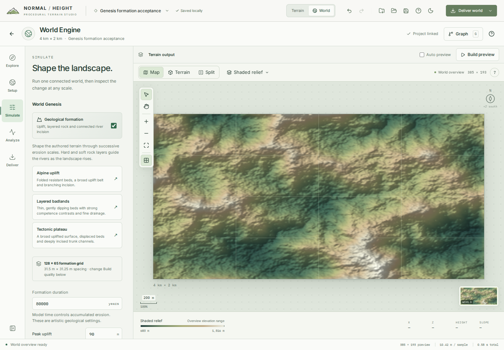
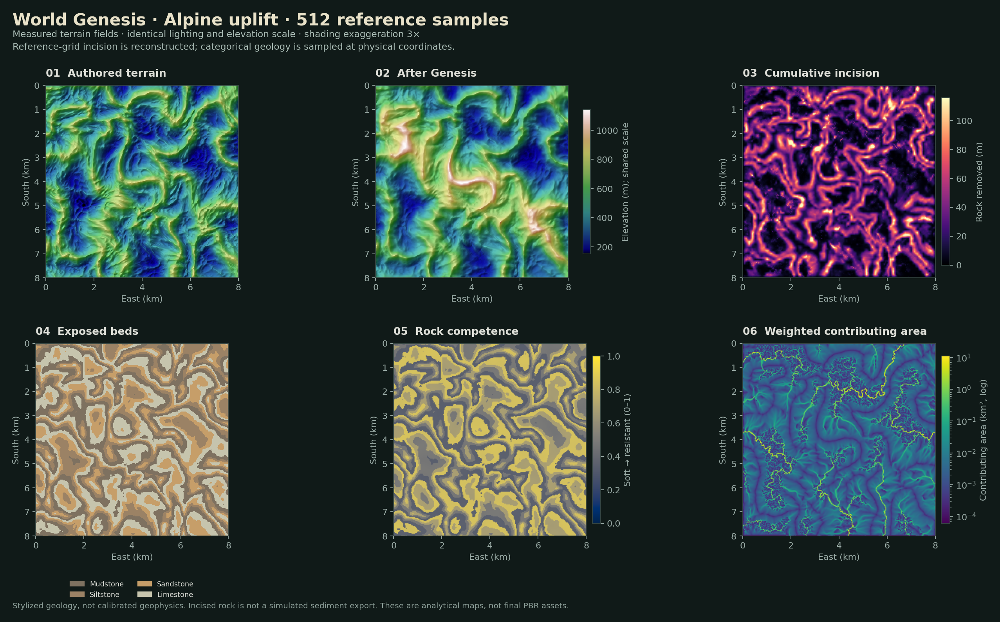
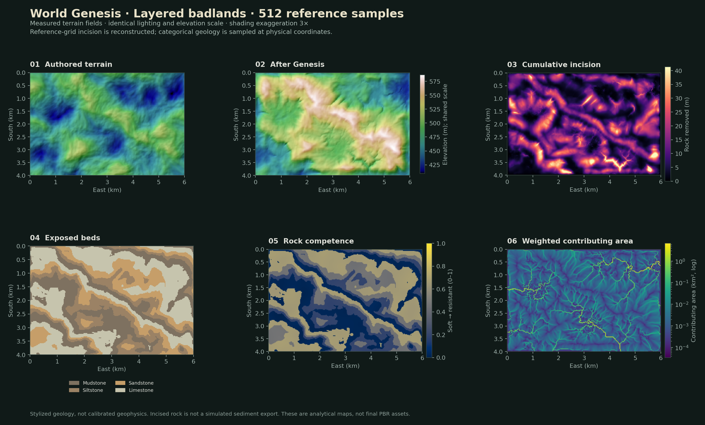
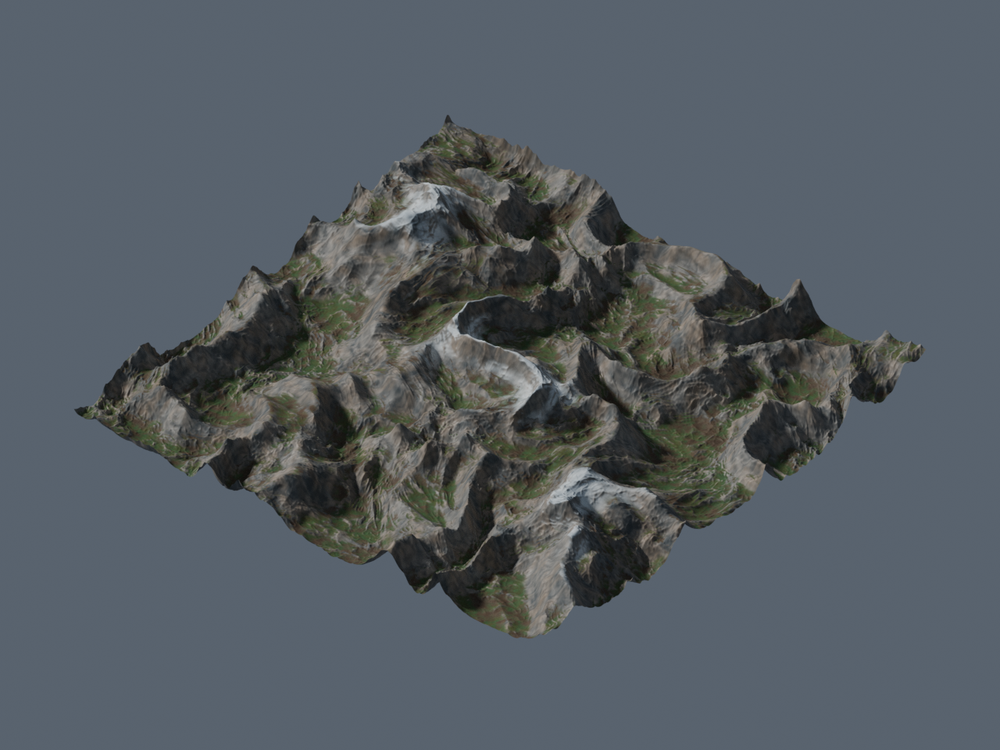

# World Genesis qualification

Evidence captured on 27 November 2026 for the first geological formation milestone.

The runtime implementation was measured from clean commit
[`a02881f4595ef66182b62087d41a1b4e19f4be20`](https://github.com/dovvnloading/Normal-Height/commit/a02881f4595ef66182b62087d41a1b4e19f4be20).
Later commits add the evidence files and reproduction tools. The change is reviewed in
[PR #71](https://github.com/dovvnloading/Normal-Height/pull/71), stacked on the production
foundation in #70.

This document records observed behavior for the stated examples and environments.
The [World Genesis guide](WORLD_GENESIS.md) defines the model, encodings, sampling
semantics and limitations.

## Release checks

| Gate | Observed result | Evidence |
| --- | --- | --- |
| Unit, numerical, project, cache and archive contracts | 733 passed; 5 skipped, including existing optional suites | [Exact-source acceptance run](https://github.com/dovvnloading/Normal-Height/actions/runs/46068678319) |
| Production TypeScript/Vite build | Passed | Same acceptance run |
| Actual Chromium browser workflows | 12 passed, one worker, zero retries; 1.8 minutes | [Browser evidence artifact](https://github.com/dovvnloading/Normal-Height/actions/runs/46068678319/artifacts/15231424414) |
| Blender 4.3.2 bridge qualification | RAW32, RAW16 and PNG16 import/render, rollback, large-origin rebase, and offline reopen passed | [Exact-source Blender run](https://github.com/dovvnloading/Normal-Height/actions/runs/46068678314), [recorded report](benchmarks/world-genesis-blender-ci.json) |
| Complete 1024 × 1024 all-map archive | Built and explicitly verified: 64 tiles, 1,088 map payloads | [Package qualification](benchmarks/world-genesis-alpine-1k.json) |
| Numerical and visual formation review | Four clean-source CPU measurements; both 512-reference examples inspected | Reports and figures below |

The browser gate exercises formation authoring, preset application, build/report,
geology layers, physical probes, PBR rendering, saved recipe persistence, and
cancellation retaining the last completed build. It also exercises the existing
World workspace, preview cache, transport and material delivery workflows.



The screenshot is from the exact-source browser run. It deliberately shows both
the **128 × 65 formation reference** and the **385 × 193 preview**; those are
different grids. All five Genesis screenshots were inspected. The artifact SHA256
is `bff4fabe629fff191edf8478c1b950ad3f6c4f7eb2b58f306b0859092944bbd2`.

Workflow artifacts use the configured 14-day retention period. The checked-in
reports, figures and reproduction commands remain available after those artifacts expire.

## Cold CPU measurements

Each row is one new Node process, run serially. Preparation includes the complete
authored graph and Genesis evolution. Sampling evaluates one full-domain output
region, including the six geology fields. PBR baking and ZIP encoding are excluded.

Environment: Node **24.22.3**, Linux x64, reported CPU **AMD EPYC 9V74 80-Core
Processor**, nine visible logical CPUs. This does not imply exclusive CPU allocation.
The solver is the CPU reference implementation.

| Example | Formation reference | Sampled output | Preparation | Sampling | Peak process RSS | Estimated peak live data |
| --- | --- | --- | ---: | ---: | ---: | ---: |
| [Alpine 256](benchmarks/world-genesis-alpine-256.json) | 256 × 256 | 257 × 257 | 1.735 s | 0.280 s | 471.0 MiB | 17.56 MiB |
| [Alpine 512](benchmarks/world-genesis-alpine-512.json) | 512 × 512 | 257 × 257 | 5.683 s | 0.364 s | 208.9 MiB | 52.25 MiB |
| [Badlands 256](benchmarks/world-genesis-badlands-256.json) | 256 × 171 | 257 × 172 | 1.214 s | 0.190 s | 185.4 MiB | 13.72 MiB |
| [Badlands 512](benchmarks/world-genesis-badlands-512.json) | 512 × 342 | 257 × 172 | 3.403 s | 0.168 s | 197.8 MiB | 36.89 MiB |

These are individual observations, not a statistical throughput distribution.
The higher RSS in the Alpine 256 observation is retained: runtime startup,
allocation and garbage collection can dominate these process measurements.
The live-data estimate and the operating-system process RSS measure different
things. The configured data budget is not a process-memory cap.

All four records contain `dirty: false`, `changedDuringRun: false`, the input
hash, the exact source revision, per-file runtime hashes and the same runtime
source fingerprint:

```text
401c2baf0d83bcf7e0ab2c701407d3c6e1ff06b4a003520f43970f3c16fd6f9e
```

The fingerprint scope is recorded in each report. It covers tracked/untracked
runtime sources, scripts and the named build configuration files, including
deleted tracked paths. Reported field hashes permit comparison without comparing
nondeterministic elapsed-time fields.

### Numerical accounting

Across these four runs, the largest absolute drainage-area residual was
**2.131 × 10⁻⁶ m²**. The largest measured hillslope exchange residual was
**9.687 × 10⁻⁸ m³**. The largest complete volume-ledger discrepancy was
**0.001759 m³**, against uplift and incision terms on the order of billions of
cubic metres.

The complete ledger comparison is:

```text
final volume change - (uplift - incision + hillslope residual + reconstruction)
```

Reconstruction is included as a separately measured term. Incised rock is not
claimed to have been transported to, or deposited at, an outlet. These observations
do not establish convergence across different formation resolutions. Shared crops
and tiles instead reuse the same prepared world/reference solution.

## Actual formation fields

The two figures were generated from the raw before/after fields exported by the
benchmark harness. The before/after images share an elevation scale and lighting.
The **3× shading exaggeration** is explicitly labeled; the figures are diagnostic
maps rather than material renders.





The Alpine example spans **8 × 8 km**. Its 512 × 512 final reference spacing is
**15.66 m**. The Badlands example spans **6 × 4 km** with a 512 × 342 reference,
approximately **11.74 × 11.73 m** spacing.

Multi-flow runoff accumulation replaced the initially reviewed single-direction
accumulation because visible directional bands remained on smooth slopes. The
versioned implementation distributes area across connected downhill neighbors;
the primary receiver still controls incision. The figures show that implemented
distinction rather than implying a complete sediment/fluid solver.

## Full asset package

The saved Alpine example was exported at **1024 × 1024 samples**, with a
**256 × 256 Genesis reference** and **128 intervals per tile**. The asset covers
8 × 8 km with **7.8201 m** output spacing; its formation reference spacing is
**31.3725 m**.

The actual archive contained **64 tiles**, **1,088 map payloads**, and **1,091 total
files**. Every tile included:

- Float32 physical height;
- all six geology fields: hardness, lithology, uplift, incision, drainage area and channel;
- all ten requested material outputs: base color, roughness, AO, ORM, splat,
  curvature, OpenGL and DirectX material normals, OpenGL detail normals and relief.

Actual archive size was **46,441,669 bytes (44.29 MiB)**. Build wall time was
**42.950 s**, including source loading; CLI-measured work was **42.079 s**.
Peak process RSS was **246.84 MiB**. The subsequent explicit verifier completed
in **1.570 s**. The archive embeds the tested source revision with `dirty: false`.

Archive SHA256:

```text
ae90b063d900ffc7782f5aade6816248d7d38a8952ea80ef60aeb7cb78a12621
```

The [machine-readable record](benchmarks/world-genesis-alpine-1k.json) contains the
exact build/verify commands, timings, data-budget estimate, counts, dimensions,
per-channel coverage and provenance. A repeat build can produce a different archive
hash because generation reports contain timings.

## Blender delivery qualification

The exact-source CI fixture contains nonzero Genesis formation, all six geology
fields, and PBR maps in all three supported height encodings. Each imported
format has four tiles, 884 vertices including duplicate borders, 825 unique
samples and 59 shared-sample comparisons.

Across those imports, maximum measured geometry error was **0.00001018 m**,
maximum normal angular error **0.02523°**, maximum UV error **2.805 × 10⁻⁸**, and
maximum decoded texture error **5.961 × 10⁻⁸**. The saved scene was reopened in a
second Blender process after every original archive was made unavailable.
Geometry, packed texture pixels and color spaces were identical.

These small-fixture measurements qualify the exercised importer contracts.
The larger actual-asset inspection is recorded separately; it must not inherit
a small fixture's numerical thresholds without measurement.

### The actual 1024-square Alpine asset

The complete 64-tile package was imported into Blender 4.3.2 and rendered using
its exported base color, ORM and detail-normal textures. It contains **1,062,961
vertices including shared borders**, **1,048,576 unique samples**, and
**1,046,529 quad faces**. Its height remained at physical **1× scale**; no
sculpting, extra displacement or generated imagery was added.



The overview uses Cycles on the CPU, 48 samples, no denoising, a 1280 × 960 frame,
AgX and restrained sun/environment lighting. The [asset inspection record](benchmarks/world-genesis-alpine-blender.json)
preserves the archive hash, scene settings, geometry/texture measurements and
the normal precision distribution.

| Larger-asset measurement | Observed value |
| --- | ---: |
| Maximum geometry error against physical source coordinates | 0.1201 mm |
| Maximum shared-border position difference | 0.1221 mm |
| Normal angular error, median | 0.000811° |
| Normal angular error, 99th percentile | 0.006574° |
| Maximum decoded normal angular error | 0.175314° |
| Shared-border angular difference, 99th percentile | 0.006340° |
| Maximum shared-border angular difference | 0.175950° |
| Maximum UV error | 2.96 × 10⁻⁸ |
| Maximum decoded texture error | 5.96 × 10⁻⁸ |

**The larger asset exceeds the small fixture's 0.06° normal threshold.** The
first inspection stopped at that threshold. Subsequent inspection retained the
failed threshold flags and measured all 4,186,116 decoded loop normals before
rendering. Conversion of the canonical source normals to Float32 introduced at
most 0.00000296° of error; the larger discrepancy appears after Blender stores
and exposes the custom normals. This points to Blender's custom-normal
representation rather than different terrain derivatives supplied to neighboring
tiles. The maximum occurs at an isolated tile corner. The small fixture and its
original thresholds remain unchanged.

The image passed visual review for the complete asset. It does not establish
bit-identical shading across Blender tile objects or a universal sub-0.06° bound.
Keep the measured tail in view when specifying downstream normal tolerances.

## Reproduce the evidence

Run from the repository root after installing its locked JavaScript dependencies.
Use new output paths: the benchmark harness does not overwrite existing reports.

```sh
npm ci
npm test
npm run build

node scripts/genesis-benchmark.mjs examples/genesis-alpine.nhterrain.json \
  --resolution 512 --samples 257 \
  --out test-results/alpine-512.json \
  --fields test-results/alpine-512-fields

python scripts/genesis-visual-report.py test-results/alpine-512-fields \
  --title 'World Genesis · Alpine uplift · 512 reference samples' \
  --out test-results/alpine-512.png

node scripts/nh.mjs build examples/genesis-alpine.nhterrain.json \
  --out test-results/alpine-1k.zip --samples 1024 \
  --global-resolution 256 --tile-intervals 128 --format raw32 \
  --maps hardness,lithology,uplift,incision,drainageArea,channel,basecolor,roughness,ao,orm,splat,curvature,materialNormalGL,materialNormalDX,detailNormalGL,relief \
  --json

node scripts/nh.mjs verify test-results/alpine-1k.zip --json
node integrations/blender/qualify.mjs test-results/blender-qualification

blender --background --factory-startup --python-exit-code 1 \
  --python integrations/blender/render-genesis-example.py -- \
  --archive test-results/alpine-1k.zip \
  --directory test-results/alpine-blender
```

The plotting script requires NumPy and Matplotlib. The Blender qualification
requires Blender 4.3.2 on the executable path, or `NH_BLENDER_PATH`. Browser CI
installs its recorded Chromium build and runs the five named World spec files
with one worker and no retries.

## Remaining production boundaries

This milestone establishes a versioned, inspectable geological formation stage
and tested delivery contracts. Native fine-grid erosion, conservative regional
refinement, GPU acceleration, authored river/lake surfaces, richer physical
material/climate coupling, ecosystem scatter, and volumetric cliff/cave assets
remain separate engineering milestones. Unreal and Unity editor imports are
still experimental. The geological RAW fields are available to downstream
shaders; they are not automatically turned into Blender material layers.

Use the reported formation spacing to judge detail. Increasing asset sample
count alone cannot add an uncomputed erosion solution.
