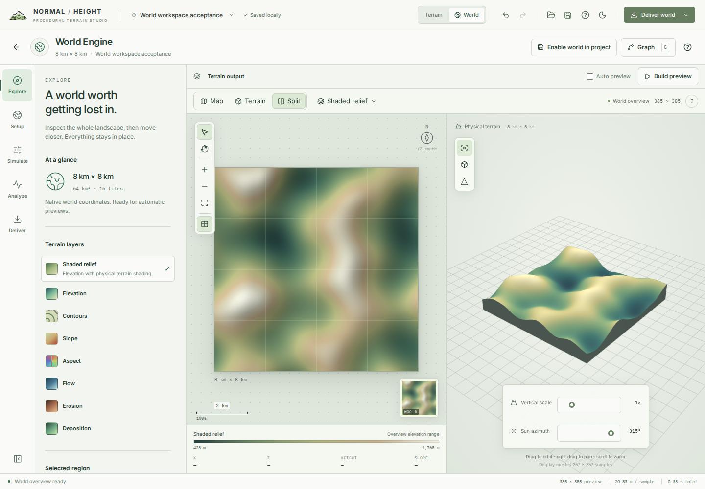
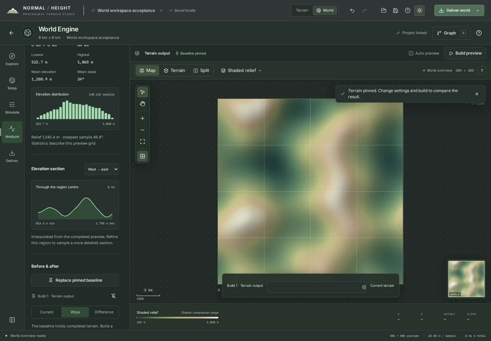
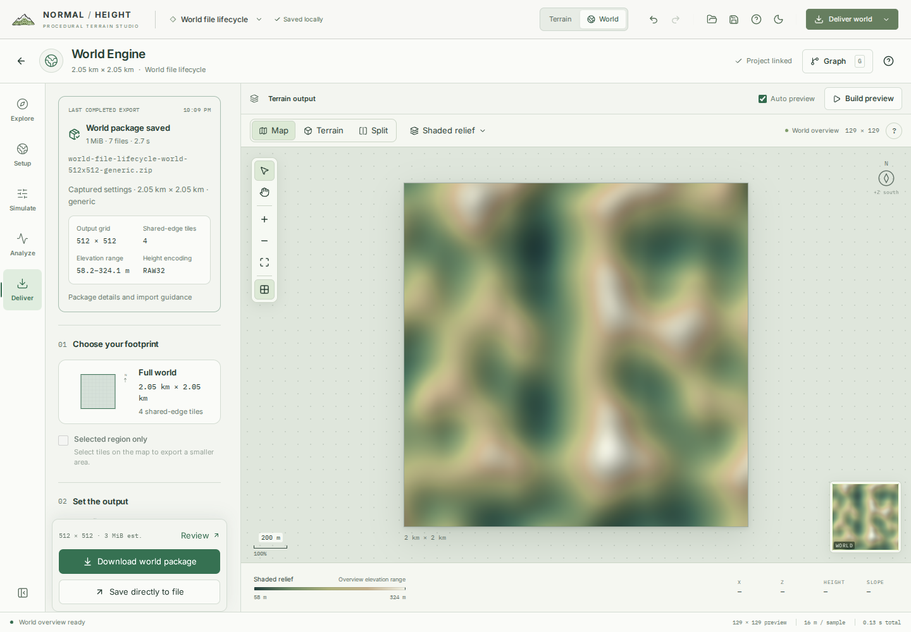

# World workspace

World Engine is a persistent workspace for exploring, shaping, inspecting and delivering terrain in one physical coordinate system. Open **World Studio** from the Terrain workspace, then move between the five modes without losing the current terrain, selected region or running export.

## The working flow

| Mode         | What to do here                                                                                                                                                  | Feedback to look for                                                                                                             |
| ------------ | ---------------------------------------------------------------------------------------------------------------------------------------------------------------- | -------------------------------------------------------------------------------------------------------------------------------- |
| **Explore**  | Pan and zoom, choose a terrain layer, select tiles, refine a region, or save a named region bookmark.                                                            | Selection footprint, cursor coordinates, elevation, map scale, preview spacing and the retained overview.                        |
| **Setup**    | Choose a physical extent, spacing, origin, height scale, datum and boundary. Exact cell counts remain available in the advanced section.                         | Actual interval counts and spacing, local input validation, graph compatibility and project-save feedback.                       |
| **Simulate** | Choose the whole-domain reference resolution, configure optional water/sediment transport, select a compute backend and manage the local region cache.           | Named build phases, real work counts, completed transport budgets and the last complete terrain.                                 |
| **Analyze**  | Inspect a sample, elevation distribution, centre-line elevation section and evaluated stage provenance. Pin a completed build and compare it with another build. | Physical measurements, the preview grid behind those measurements and any reconstructed global stages.                           |
| **Deliver**  | Choose a full-world or selected-region footprint, output profile, sample count, encoding and maps. Review the two destination budgets, then create a package.    | Exact dimensions, meters per sample, estimated memory, counted export phases, written bytes and a persistent completion receipt. |

The procedural graph can be opened as a resizable dock in the World workspace. Selecting an intermediate graph output updates the inspected preview; **Return to output** returns to the terrain output. Delivery always evaluates the full authored output plus explicitly selected mask branches.

Valid World settings are linked back to the project through the normal project history and persistence path. An incomplete numeric edit stays in its field until it is committed with Enter or blur. Escape restores the current authored value. A failed save keeps the draft visible and reports the problem.



## Navigation and display

The map uses local Cartesian meters: +X is east, +Z is south, and the first raster row is north. Elevation is `datum + normalized terrain height × heightScale`. These coordinates are not a geographic coordinate reference system.

Choose **Map**, **Terrain**, or **Split**. The 3D terrain is built from the completed World samples; it does not use the separate Terrain workspace heightfield. The mesh is bounded to at most 257 samples per axis. Camera, projection, sun direction, wireframe and vertical exaggeration affect presentation. A display exaggeration never changes the authored height scale or export values.

| Input                                             | Action                                                             |
| ------------------------------------------------- | ------------------------------------------------------------------ |
| Scroll or pinch on the map                        | Zoom around the cursor or gesture centre.                          |
| Space + drag, middle-button drag, or the pan tool | Move the map.                                                      |
| Click or drag with the selection tool             | Select one tile or a rectangular group of tiles.                   |
| Shift while selecting                             | Extend the selection.                                              |
| Arrow keys with the map focused                   | Move the tile selection. Shift extends it.                         |
| `F`                                               | Frame the selected region; fit the world if there is no selection. |
| `Home`                                            | Fit the world.                                                     |
| `+` / `−`                                         | Zoom in or out.                                                    |
| `Enter` on a selected region                      | Build a bounded detail preview.                                    |
| `Escape`                                          | Clear the selection or close map overlays.                         |
| `Shift + G`                                       | Toggle the map tile grid.                                          |
| `G`                                               | Toggle the graph dock.                                             |
| `Ctrl/⌘ + Enter`                                  | Build or cancel the World preview.                                 |
| `Alt + 1` … `Alt + 5`                             | Open Explore, Setup, Simulate, Analyze or Deliver.                 |
| `?`                                               | Open navigation help.                                              |
| Left drag in 3D                                   | Orbit.                                                             |
| Right drag in 3D                                  | Pan the camera.                                                    |

The map's navigator retains whole-world context when inspecting a smaller region. A scale bar, orientation, selection outline and live probe remain tied to the same physical coordinates. Keyboard controls cover map navigation, tile selection, panel resizing and mode changes. Reduced-motion preferences disable decorative motion and smooth feedback scrolling.

## Resolution and progress mean specific things

There are three separate resolutions:

1. **Authored world grid:** the domain's interval counts and physical dimensions describe the coordinate lattice and tile selection boundaries.
2. **Preview sampling:** an overview is bounded to 385 samples on its longest axis; regional detail is bounded to 513. Aspect follows the physical footprint, and the request is also limited by the selected region's authored intervals.
3. **Global reference and export sampling:** globally evaluated stages share one whole-domain reference solve. Their simulation resolution and actual spacing are listed in the stage report. Export sample counts determine the output lattice; they do not increase the resolution of those reference solves.

Native, supported graphs can preview automatically after edits. Expensive global work can remain manual with **Auto preview** off. **Refine as you explore** schedules a bounded region after navigation settles, coalesces intervening camera requests and reuses prepared whole-world context where the semantic graph and domain still match.

The previous completed field stays visible while replacement work runs. A stale label identifies the displayed build when graph or world settings change. Responses from cancelled or superseded jobs cannot replace the current result. Node layout and labels are presentation metadata; moving or renaming a node does not invalidate its numerical terrain.

Preview progress names the current preparation, transport, sampling or cache operation. Percentages are derived from available stage, row, sample or iteration counts. Compilation and storage operations with no measurable denominator are indeterminate. Elapsed time is a measurement, not an estimated completion time.

The stage report separates sampling duration from the total preview lifecycle. Memory values shown in the UI are conservative allocation estimates, not process-memory measurements. Choosing Auto or WebGPU still leaves unsupported/global stages on their documented CPU path; the backend explanation and per-stage report identify what actually ran.

## Inspecting and comparing terrain

Elevation, physical slope and aspect are calculated from the sampled field and its meter spacing. Flow, wear and deposition are diagnostic signals; their legends and probes use relative/scalar units. Whole-domain transport budgets report their own measured water and solid volumes in physical units.

Statistics, histograms and elevation sections describe the completed preview grid. Refining a region provides more sampled detail. The stage report identifies any global reconstruction that still limits simulation detail.

**Pin current terrain** retains a completed field in memory. Wipe and elevation-difference comparisons require the same physical footprint. Compatible fields with different sample counts are interpolated for display. Both sides use a common color range, and differences compare physical elevations including scale and datum. The pinned field remains unchanged while a replacement build runs. Comparison mode holds its footprint instead of scheduling navigation-driven sampling.



## Delivery is an independent job

Delivery starts with a captured copy of the project, World definition, region, maps, profile and output dimensions. Changing workspace or continuing to explore does not change that package. Returning to Terrain keeps the export alive. Explicit **Cancel export** stops its worker and requests abort of an open writable stream; component disposal also cleans up a job and invalidates a still-pending file picker.

The action dock stays reachable while reviewing settings. A job, failure or completion moves into view when its state changes. The receipt is visibly labeled **Last completed export**, with its completion time and captured footprint, so later edits remain distinct from the finished package.



### Output contracts

| Choice            | Contract                                                                                                                                                                                                   |
| ----------------- | ---------------------------------------------------------------------------------------------------------------------------------------------------------------------------------------------------------- |
| Generic Cartesian | Exact output sample counts up to 8192 per axis. The east sample count is chosen explicitly; the south count follows the physical aspect and the supported per-axis limits. Both actual spacings are shown. |
| Unreal Landscape  | Supported square sample counts and 16-bit PNG or unsigned 16-bit little-endian RAW. The manifest includes import scales and placement values.                                                              |
| Unity Terrain     | Square power-of-two interval counts plus one sample, with unsigned 16-bit little-endian RAW and shared vertical transform.                                                                                 |
| Float32 RAW       | Physical elevation in meters, little-endian, row-major, without a header.                                                                                                                                  |
| 16-bit PNG / RAW  | One common output-region elevation range for all tiles; the manifest gives the exact decoding transform.                                                                                                   |
| Diagnostic maps   | Flow, wear, deposition and physical slope. Units and ranges are recorded per channel.                                                                                                                      |
| Normal map        | OpenGL tangent-space +Y with halo samples for continuous internal tile derivatives.                                                                                                                        |
| Authored masks    | Selected mask branches evaluated in world coordinates with fixed 0–1 weight encoding.                                                                                                                      |

Engine profiles remain experimental until real editor imports are verified. The archive includes that qualification and its exact data contracts.

### Destination checks

**Browser download** and **Direct file save** are preflighted separately. Both validate dimensions, graph support, mask branches and conservative working-memory requirements before opening a worker or file picker. Browser downloads also enforce the 192 MiB retained-archive limit. Direct file saving streams chunks to the selected writable file and excludes archive retention from the memory estimate.

A blocked destination shows its own reason and, when possible, the largest smaller preset that passes the same execution checks. A file save can therefore be available while a browser download is too large. Browsers without a native file-save picker retain the download path and its smaller-output/region remedies.

### Export feedback and recovery

| Phase   | What is measured                                                                                                 |
| ------- | ---------------------------------------------------------------------------------------------------------------- |
| Prepare | Named graph/global preparation work; indeterminate duration.                                                     |
| Measure | Completed tiles in the common elevation-range pass.                                                              |
| Encode  | Completed terrain tiles; mask encoding counts its own mask-tile work.                                            |
| Package | Manifest, import notes, original project and ZIP finalization; indeterminate duration.                           |
| Save    | Bytes successfully accepted by the writable sink, or bytes assembled for download; final close/download handoff. |

Each percentage belongs to the current counted phase. A weighted historical progress callback remains compatible with existing engine consumers, but the new UI does not present it as a time estimate.

The worker waits for an acknowledgment after each chunk. The client sends it only after a file write resolves, preserving bounded backpressure. Startup, message, encoding, write, close and download errors release the worker and clear the busy state. **Retry export** uses the captured request. Late picker results, late writes and late worker events cannot complete or overwrite a cancelled/newer job.

A completion receipt shows the actual filename, bytes, file count, duration, output grid, tile count, elevation range and encoding. Browser delivery says **Download initiated**; a native writable reports **World package saved** after close succeeds. The actual manifest can be downloaded from the receipt. Shared edge/corner sample contracts, common quantization, checksums and portable project data remain the same as the World export engine.

## Persistence boundaries

World definition and graph edits belong to the portable terrain project and normal undo/redo history. Display mode, layer, panel width and preview/cache preferences are saved as browser presentation settings. Named regions are stored in a bounded per-project browser shelf and are scoped to their physical domain. Pinned fields, completion receipts and the current job live for the mounted workspace session. Persistent region caching is an explicit opt-in; clearing it preserves the authored project and displayed terrain.

## Verification

Run from the repository root with the project's supported Node version:

```sh
npm ci
npm test
npm run build
npx playwright install chromium
npx playwright test tests/e2e/world*.spec.ts --workers=1
```

Focused numerical, lifecycle and presentation checks:

```sh
npx vitest run tests/world-preview.test.ts tests/world-view-math.test.ts tests/world-analysis.test.ts tests/world-view-settings.test.ts tests/world-export.test.ts src/export/worldExportClient.test.ts src/export/worldExportPlan.test.ts
```

The file-export browser suite uses a controlled picker/writable boundary with real production workers, terrain generation, ZIP encoding, chunk acknowledgments and RAW decoding. It covers pending-picker cancellation, a late writable, background workspace navigation, write failure/retry and worker startup failure/retry. These checks do not qualify native OS picker behavior.

The larger CPU/browser export profile is explicitly enabled:

```sh
WORLD_BROWSER_PROFILE=1 npx playwright test tests/e2e/world-highres.spec.ts
```

For release review, inspect light and dark themes at desktop and compact widths, exercise keyboard selection and panel resizing, compare pinned builds on the same footprint, and check a real downloaded package's manifest against its imported terrain. Record measured timing results for the tested hardware and graph instead of inferring them from a progress bar.

Related contracts: [World engine](WORLD_ENGINE.md), [world hydrology](WORLD_HYDROLOGY.md), and [verification](VERIFICATION.md).
